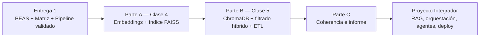

# TP Integrador — Entrega 2: Del Prompt Saturado a la Base de Conocimiento Vectorial

*Trabajo Práctico entregable — Clases 4 y 5 (Unidad 3)*

**Asignatura:** Desarrollo de Sistemas de Inteligencia Artificial

**Objetivo del TP:** construir la capa que le faltaba al sistema de la Entrega 1 — la **Base de Conocimiento**. Pasar de "meter todo el contexto en el prompt" a una memoria vectorial externa, migrando de un prompt con contexto estático a una arquitectura de recuperación con FAISS y ChromaDB: filtrado híbrido, ETL y purga semántica.

---

## Cómo funciona esta entrega

- **Se apoya directamente en la Entrega 1.** La columna "Base de Conocimiento" del PEAS y los campos de filtrado de la Matriz se vuelven, respectivamente, los **documentos** y los **metadatos** de la base vectorial.
- **Ortelana Textil es el ejemplo guía**, no el entregable. Ustedes replican todo sobre **su propio dominio**.
- **El dominio no se cambia.** Se mantiene el mismo de la Entrega 1.
- **Modalidad:** grupal, mismo repositorio Git de la Entrega 1.

---

## El hilo conductor



| Parte | Pregunta que responde | Artefacto que produce |
|---|---|---|
| **A** | ¿Por qué el prompt estático no escala, y cómo se busca por significado? | Similitud coseno a mano + `base_conocimiento.json` (≥15 docs) + índice FAISS persistido |
| **B** | ¿Cómo se convierte ese índice en una base de datos real, consultable y filtrable? | Colección ChromaDB persistente + CLI de búsqueda híbrida + ETL y purga semántica |
| **C** | ¿Esta base es coherente con lo que diseñaron en la Entrega 1? | `informe_entrega2.md` + tabla de Killer Queries |

> [!TIP] **Regla del Arquitecto para metadatos**
> Todo campo sobre el que haya que aplicar un **filtro duro** (sucursal, vigencia, categoría, stock) va como **metadato**. Lo narrativo o sensorial (textura, contexto, matices) queda **dentro del texto**. Nunca al revés.

---

## Parte A — Embeddings y Búsqueda Semántica (Clase 4)

### A.1 — Autopsia del contexto estático

Documenten, aplicado a su dominio, los tres problemas de meter toda la Base de Conocimiento en el System Prompt:

| Problema | Aplicado a su dominio |
|---|---|
| **Desangre de tokens** | ¿Cuántos documentos tiene la base? ¿Qué costo tendría pasarlos todos en cada consulta? |
| **Lost in the Middle** | ¿Qué pasa cuando el dato relevante queda en el medio de un bloque de texto masivo? |
| **Inconsistencia de estado concurrente** | ¿Qué dato de su dominio cambia mientras el usuario está en la sesión? |

Cierre en 2-3 líneas: ¿por qué un `SELECT ... WHERE descripcion LIKE '%...%'` tampoco resuelve esto?

### A.2 — Similitud coseno a mano

Reduzcan su dominio a **dos ejes** con sentido. Definan 2-3 vectores 2D (documentos) y 1 vector de consulta. Calculen la similitud coseno a mano mostrando los tres pasos:

```
Similitud = (A · B) / (‖A‖ × ‖B‖)
```

Validen con NumPy:

```python
import numpy as np
def similitud_coseno(a, b):
    return np.dot(a, b) / (np.linalg.norm(a) * np.linalg.norm(b))
```

Reflexionen en 2-3 líneas sobre el **umbral de aceptación**: ¿a partir de qué score un resultado es "lo bastante parecido"? ¿Qué hace el sistema si nada lo supera?

### A.3 — `base_conocimiento.json` — mínimo 15 documentos

Cada registro con esta estructura exacta:

```json
{
  "id": "DOC-001",
  "descripcion_semantica": "Párrafo rico: contexto, usos, matices, sinónimos... — el texto que se va a vectorizar.",
  "metadatos": {
    "<campo_categorico>": "valor",
    "<booleano_de_estado>": true,
    "tags_regionales": ["término comercial", "sinónimo", "jerga"]
  }
}
```

Requisitos: ≥15 documentos reales o creíbles; `descripcion_semantica` en **párrafo**, no dos palabras; metadatos con al menos un campo categórico, un booleano de estado y `tags_regionales`; esquema justificado con la Regla del Arquitecto.

### A.4 — Índice FAISS (`pipeline_vectorial.py`)

Un script que:
1. Lea credenciales desde `.env` (nunca hardcodeadas).
2. Genere embeddings de las `descripcion_semantica` con `text-embedding-3-small` (o el modelo que usen).
3. Construya un `IndexFlatL2` (o `IndexFlatIP` con vectores normalizados).
4. **Persista** el índice con `faiss.write_index()` y lo recargue con `faiss.read_index()` si ya existe.
5. Corra búsqueda semántica top-K sobre 3 consultas de prueba, reportando resultado y distancia de cada una.

### A.5 — Prueba destructiva: volatilidad de la RAM

Esta prueba es la única evidencia real de que la persistencia funciona — sin ella, "el índice persiste" es una afirmación, no un hecho demostrado. Documenten (log o captura):
- Construir el índice **sin** `write_index()` → reiniciar el entorno → el índice se perdió, hay que regenerar (y pagar tokens de nuevo).
- Hacerlo **con** `write_index()` → el índice se recarga desde disco sin consumir tokens.

Reflexión en 2 líneas: ¿qué pasa en producción si el servidor se reinicia? ¿Y si hay dos servidores?

---

## Parte B — ChromaDB, Filtrado Híbrido y ETL (Clase 5)

### B.1 — Migración a ChromaDB

Cargar la misma base de A.3 en ChromaDB: `PersistentClient` con ruta en disco (no `Client()` volátil), colección con `metadata={"hnsw:space": "cosine"}`, ingesta con `upsert` (no `add`) para poder re-ejecutar sin duplicar.

### B.2 — Los tres límites de FAISS que ChromaDB resuelve

| Límite de FAISS | Cómo se manifiesta en su dominio | Cómo lo resuelve ChromaDB |
|---|---|---|
| Sin persistencia transaccional / atomicidad | | |
| Sin filtrado híbrido nativo | | |
| CRUD ineficiente / sin concurrencia | | |

### B.3 — Evento de negocio en caliente

Simulen un cambio de estado real (`coleccion.upsert(ids=["DOC-00X"], documents=[...], metadatas=[{...}])`) y verifiquen con `coleccion.get(ids=["DOC-00X"])`. Expliquen en 2 líneas por qué `upsert` y no `add` ni `update`.

### B.4 — CLI de búsqueda híbrida

Una función `buscar_<dominio>(query_semantica, filtro_X, solo_activos, n_resultados)` que combine búsqueda semántica (`query_texts`) con filtro duro por **operadores nativos**:

```python
where={"$and": [{"campo": {"$eq": valor}}, {"activo": {"$eq": True}}]}
```

> [!WARNING] **Prohibido el post-filtering manual.** Si filtran con un `if` de Python después de la query, el sistema funciona pero calcula similitud sobre documentos que iba a descartar. El filtro va **dentro** del `where`.

### B.5 — ETL y purga semántica

Agreguen a mano al dataset: 2-3 casi-duplicados (mismo concepto, distinto id/texto/jerga) y 2 inconsistencias estructurales (clave mal nombrada, booleano cargado como string). Escriban `etl_purga.py`: normaliza claves/tipos, resuelve colisión de IDs, y hace la purga semántica (vectoriza, detecta pares bajo un umbral de distancia coseno justificado, elimina el duplicado). Reporten qué se eliminó y por qué un `SELECT DISTINCT` no lo habría encontrado.

### B.6 — Killer Queries

3 consultas trampa. Completar:

| # | Consulta | Qué pone a prueba | Resultado esperado | Resultado real | ¿Pasó? |
|---|---|---|---|---|---|
| 1 | | Poder semántico: jerga sin palabras exactas del documento | | | |
| 2 | | El metadato salva el día: la semántica cruda traería un desastre, el filtro lo bloquea | | | |
| 3 | | Prueba de estrés: consulta fuera del catálogo — debe responder "no tengo eso" | | | |

---

## Parte C — Coherencia e Informe

### C.1 — Cadena de coherencia con la Entrega 1

| Elemento de la Entrega 1 | Cómo se implementa en la Entrega 2 |
|---|---|
| Columna "Base de Conocimiento" del PEAS | ← la colección ChromaDB con estos documentos |
| Campos de filtrado de la Matriz de Intenciones | ← los metadatos de la base |
| Parámetros que el LLM extraía del `texto_libre` | ← ahora se resuelven en el `where` de la query |

### C.2 — El umbral de aceptación

¿Qué threshold definieron? ¿Qué responde el sistema cuando ninguna coincidencia lo supera? (forzar el resultado más cercano es alucinación; responder "no tengo esa información" es lo correcto).

### C.3 — Cierre: dónde se conecta

En 3-4 líneas: la búsqueda híbrida devuelve un dict de Python. ¿Qué componente falta para que sea una respuesta real al usuario? (pista: el orquestador — RAG con LangChain, Unidad 4).

---

## Qué se entrega

El mismo repositorio Git de la Entrega 1 — **público**, se entrega solo el link — con:

| Archivo | Contenido |
|---|---|
| `base_conocimiento.json` | Los ≥15 documentos de A.3 — la fuente de verdad, la base se reconstruye entera desde acá |
| `pipeline_vectorial.py` | El índice FAISS de A.4 |
| `vector_db.py` o `.ipynb` | ChromaDB persistente + CLI de búsqueda híbrida (B.1–B.4) |
| `etl_purga.py` | ETL + purga semántica de B.5 |
| `informe_entrega2.md` | Partes A y B (narrativa y tablas, incluida la prueba de A.5) + Parte C completa |
| `resultados_killer_queries.md` | La tabla de B.6 con resultados reales |
| `requirements.txt` | Todas las dependencias con versión |
| `README.md` / `.env.example` / `.gitignore` (actualizados) | Cómo correr todo; `.env` y los binarios de FAISS/ChromaDB ignorados |

> [!WARNING] **El repo es público — ninguna clave entra al repositorio, nunca.** Ni siquiera en un commit que después borran: queda en `git log` y los bots de GitHub/GitLab escanean en tiempo real — una key expuesta se compromete en minutos. `.env` en `.gitignore` desde el primer commit, solo se sube `.env.example` sin valores; si una key se filtró, hay que **rotarla**.

---

## Rúbrica de evaluación

Cada criterio se puntúa en uno de cuatro niveles: **No logrado (0%)**, **En desarrollo (40%)**, **Logrado (75%)**, **Destacado (100%)** del máximo. El total suma 10, igual que la escala del aula virtual.

| # | Criterio | Logrado (75%) significa que... | Máx |
|---|---|---|---|
| 1 | **Autopsia del contexto estático** (A.1) | Los tres problemas explicados con datos concretos del dominio | 0.8 |
| 2 | **Similitud coseno a mano** (A.2) | Ejes propios, cálculo en 3 pasos, validación NumPy y reflexión sobre el umbral | 1.2 |
| 3 | **`base_conocimiento.json`** (A.3) | ≥15 docs ricos en párrafo, metadatos justificados con la Regla del Arquitecto | 1.5 |
| 4 | **Índice FAISS** (A.4, A.5) | Corre punta a punta, persiste y recarga sin regenerar, prueba de volatilidad hecha | 1.2 |
| 5 | **Migración a ChromaDB** (B.1–B.3) | `PersistentClient`, `cosine`, `upsert`; los tres límites de FAISS explicados; evento en caliente verificado | 1.3 |
| 6 | **Búsqueda híbrida** (B.4) | Filtro en el `where` con operadores nativos, sin post-filtering manual | 1.2 |
| 7 | **ETL y purga semántica** (B.5) | Normaliza claves/tipos, resuelve IDs, purga por umbral justificado | 1.3 |
| 8 | **Killer Queries** (B.6) | Las 3 consultas son genuinamente trampa, tabla con resultados reales | 1 |
| 9 | **Coherencia transversal + cierre** (C.1–C.3) | Enganche explícito con PEAS/Matriz de E1; umbral definido; C.3 identifica al orquestador RAG como lo que falta | 0.5 |
| | **Total** | | **10** |

**Penalizaciones** (se restan del total):

| Situación | Penalización |
|---|---|
| API key real en algún commit (aunque esté borrada después) | −1.5 y aviso para rotar la key |
| `.env` no está en `.gitignore` | −0.5 |
| El directorio binario de ChromaDB o los `.index` commiteados | −0.5 |
| Post-filtering manual en Python en vez de `where` nativo | criterio 6 baja un nivel |
| Un único commit con todo volcado | −0.5 |
| El script no corre en la máquina del docente por algo evitable (path hardcodeado, dependencia sin declarar) | criterio 4 o 5 baja un nivel |
| Entrega tardía | según reglamento de la cátedra |

> [!NOTE] **Sobre la defensa oral**
> Esta entrega no tiene defensa oral individual. La instancia oral se concentra en la defensa final (Entrega 5 / Clase 16), donde se evalúa el sistema completo de punta a punta.

---

## Preguntas frecuentes

**¿Tenemos que usar OpenAI para los embeddings?**
Es lo recomendado por costo/calidad (`text-embedding-3-small`). `sentence-transformers` local es válido si no tienen créditos.

**¿La base tiene que tener exactamente 15 documentos?**
Mínimo 15. Prioricen la riqueza de cada `descripcion_semantica` sobre la cantidad.

**¿El ETL y la purga tienen que correr sobre datos reales de varias fuentes?**
No. Alcanza con agregar a mano los casi-duplicados y las inconsistencias, y que el script las resuelva.

**¿Hace falta que la Parte B esté "en producción"?**
No. Tiene que correr de punta a punta con persistencia real en disco y filtrado con operadores nativos.

**¿El repo tiene que ser público?**
Sí. Se entrega solo el link, sin gestión de accesos — por eso **ninguna clave puede entrar al repo** (ver el aviso de arriba). Si el grupo prefiere no exponer su trabajo, puede hacerlo privado, pero entonces da acceso al docente cuando lo pida.

**¿Se requiere un deploy en la nube?**
No. Toda la persistencia se evalúa localmente, sobre disco.

**¿Y si la base ChromaDB pesa mucho para el repo?**
Por eso no se commitea. Se entrega el `base_conocimiento.json` y los scripts que la reconstruyen.
