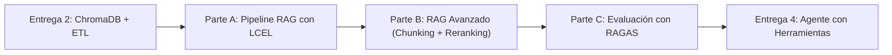

# TP Integrador — Entrega 3: Sistema RAG Completo con Evaluación

**Asignatura:** Desarrollo de Sistemas de Inteligencia Artificial (IADS 3)

**Modalidad:** Grupal (mismo repositorio)

**Objetivo:** Evolucionar la base de conocimiento vectorial de la Entrega 2 hacia un pipeline RAG completo utilizando LangChain LCEL. Se implementará chunking avanzado y reranking, finalizando con una evaluación cuantitativa usando RAGAS.

---

## Flujo de Trabajo del Proyecto

---

## Parte A — Pipeline RAG con LangChain LCEL

### A.1 Conexión a la Base de Datos

El retriever debe instanciarse apuntando exactamente a la base ChromaDB construida en la Entrega 2, respetando el mismo nombre de colección y ruta de persistencia.

### A.2 Chain LCEL Completo

Construir el pipeline integrando los cuatro componentes principales:

1. **Retriever:** Recupera los *k* documentos más similares.
2. **Prompt de contexto:** Combina los documentos y la pregunta. Debe incluir estrictamente reglas de negocio que actúen como guardrail (ej. "Responder ÚNICAMENTE con información EXPLÍCITA en el contexto", prohibición de confirmar precios no escritos, y una frase de escape clara si no hay datos).
3. **LLM:** Genera la respuesta blindada respetando las reglas del prompt.
4. **Parser:** Extrae el texto final.

Adicionalmente, se debe configurar el chain para que devuelva tanto la respuesta generada como los documentos fuente utilizados.

### A.3 Matriz de Validación de Resiliencia

Ejecutar el pipeline y documentar el comportamiento frente a 4 escenarios clave:

| Tipo de Prueba | Comportamiento Esperado |
| --- | --- |
| **Factual directa** | Responde citando los documentos correctos. |
| **Fuera de dominio** | Activa la cláusula de escape ("No poseo información..."). |
| **Ataque complacencia** | Deniega beneficios o afirmaciones falsas sin inventar datos. |
| **Uso de sinónimos** | Encuentra el documento y responde correctamente pese al cambio de palabras. |

### A.4 Trazabilidad de Fuentes

Demostrar en al menos 2 consultas que el sistema expone correctamente los documentos utilizados para fundamentar la respuesta, incluyendo el fragmento de texto y sus metadatos (sucursal, categoría, etc.).

---

## Parte B — RAG Avanzado: Chunking y Reranking

### B.1 Identificación de Fallas

Documentar al menos una consulta donde el RAG básico falle, explicando la causa técnica (Chunk cortado, Ruido en el contexto, o "Lost in the Middle").

### B.2 Chunking con Solapamiento

Reindexar el corpus aplicando solapamiento (ejemplo: tamaño de 500 caracteres con 100 de solapamiento). Documentar la cantidad de chunks nuevos frente a la versión anterior y analizar si esto resuelve la falla detectada en B.1.

### B.3 Reranking

Ampliar la cantidad de documentos recuperados (ej. `k=8`) y agregar una capa de filtrado o reordenamiento por relevancia (usando el LLM como juez) antes de pasar el contexto final para generar la respuesta.

### B.4 Captura de Traza (LangSmith)

Activar la observabilidad mediante LangSmith (configurando las variables de entorno de trazabilidad, API Key y proyecto) y documentar una traza completa que evidencie tiempos, tokens consumidos y la diferencia entre los chunks recuperados y los seleccionados tras el reranking.

---

## Parte C — Evaluación con RAGAS

### C.1 Golden Dataset

Construir un dataset con un mínimo de 10 preguntas reales del dominio y sus respuestas esperadas (*ground truth*), distribuidas así:

* 3 preguntas simples (respuesta en un chunk).
* 3 preguntas complejas (requieren combinar chunks).
* 2 preguntas de escape (el sistema debe responder que no sabe).
* 2 preguntas con lenguaje ambiguo o informal.

### C.2 Baseline RAGAS

Ejecutar la evaluación sobre el pipeline básico y documentar las métricas de:

* **Faithfulness** (ausencia de alucinaciones).
* **Answer Relevancy** (pertinencia de la respuesta).
* **Context Precision** (ausencia de ruido en chunks).
* **Context Recall** (recuperación de toda la información clave).

### C.3 Comparativa de Modelos

Contrastar los resultados obtenidos en el RAG básico frente al RAG avanzado (con chunking y reranking) utilizando una tabla comparativa. El esfuerzo técnico debe reflejarse en la mejora (*delta*) de al menos una métrica.

### C.4 Diagnóstico y Mitigación

Seleccionar la métrica con el resultado más bajo en la evaluación avanzada, identificar su causa probable y documentar una acción técnica concreta para mejorarla a futuro.

---

## Resumen de lo Pedido (Entregables)

Deberán pushear al repositorio Git la carpeta `entrega_3/` con la siguiente estructura y contenidos:

1. **Código del Pipeline (`rag_pipeline`):** El código (en `.py` o `.ipynb`) que implementa las Partes A y B conectándose a la base original.
2. **Código de Evaluación (`evaluacion_ragas`):** El código (en `.py` o `.ipynb`) que define el dataset de 10 preguntas y ejecuta RAGAS.
3. **Captura de Traza (`langsmith_trace.png`):** Una imagen o enlace público de la ejecución registrada en LangSmith (Parte B.4).
4. **Informe Analítico (`informe.md`):** Documento markdown que responda obligatoriamente a:
    * Explicación de la falla del RAG básico y su causa técnica (B.1).
    * Tabla comparativa de resultados de las métricas (básico vs avanzado) (C.3).
    * Diagnóstico de la peor métrica y la propuesta de mejora (C.4).
