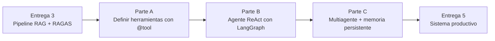

# TP Integrador — Entrega 4: Agente Inteligente con LangGraph

*Trabajo Práctico entregable — Unidad 5: Clases 9 y 10*

**Asignatura:** Desarrollo de Sistemas de Inteligencia Artificial (IADS 3)

**Objetivo de la entrega:** transformar el pipeline RAG de la Entrega 3 en un agente inteligente que decide autónomamente cuándo y cómo usar herramientas. El sistema ya no ejecuta siempre los mismos pasos — razona sobre el problema y elige el camino.

---

## Cómo funciona esta entrega

- **Se construye sobre las Entregas 2 y 3.** El RAG de la Entrega 3 no desaparece: se convierte en una herramienta de percepción del agente.
- **El dominio del TP1 define las herramientas.** Las tres herramientas de Ortelana (catálogo, crédito, normativa) son el molde — cada grupo las adapta a su dominio.
- **Modalidad:** grupal, mismo repositorio.

---

## El hilo conductor



---

## Parte A — Del RAG a las Herramientas (Clase 9, Bloque 2)

### A.1 — Mapear las capacidades del sistema como herramientas

El primer paso es convertir las capacidades del sistema en un catálogo de herramientas que el agente puede invocar. Para cada herramienta definir:

| Campo | Qué determina |
|---|---|
| **Nombre de la función** | Cuándo el LLM la elige (tiene que ser descriptivo y acotado) |
| **Docstring** | La "descripción de la capacidad" que el LLM lee para decidir |
| **Parámetros tipados** | Los inputs que el agente tiene que proveer |
| **Valor de retorno** | Lo que el agente recibe para decidir el próximo paso |

**La herramienta mínima que hereda de la Entrega 3** — el RAG como sensor de conocimiento:

```python
from langchain_core.tools import tool

@tool
def recuperar_informacion(consulta: str) -> str:
    """
    Busca información en la base de conocimiento del sistema [dominio del TP1].
    Usar cuando se necesite información sobre [especificar: políticas / catálogo /
    normativas / procedimientos / etc.]. No usar para consultas que requieran
    datos en tiempo real o del estado de un proceso específico.

    Args:
        consulta: La pregunta o tema sobre el que buscar información.

    Returns:
        Los fragmentos más relevantes de la base de conocimiento.
    """
    # El retriever de la Entrega 3 se convierte en una herramienta
    from langchain_chroma import Chroma
    from langchain_openai import OpenAIEmbeddings
    import os
    from dotenv import load_dotenv

    load_dotenv()
    embeddings = OpenAIEmbeddings(model="text-embedding-3-small")
    vectorstore = Chroma(
        collection_name="base_tp1",
        embedding_function=embeddings,
        persist_directory="./vectordb_tp1"
    )
    docs = vectorstore.similarity_search(consulta, k=3)
    if not docs:
        return "No encontré información sobre ese tema en la base de conocimiento."
    return "\n\n---\n\n".join(doc.page_content for doc in docs)
```

### A.2 — Diseñar las herramientas específicas del dominio

Cada grupo define **al menos 2 herramientas adicionales** específicas de su dominio. Una tiene que ser un **sensor** (solo lee, sin efecto secundario) y una tiene que ser un **actuador** (produce un efecto en el sistema).

**Ejemplos por dominio:**

| Dominio | Sensor ejemplo | Actuador ejemplo |
|---|---|---|
| Legal | `consultar_expediente(numero)` | `registrar_solicitud(tipo, datos)` |
| Salud | `verificar_protocolo(diagnostico)` | `generar_derivacion(especialidad, paciente_id)` |
| RRHH | `consultar_posicion(id_posicion)` | `registrar_postulacion(candidato_id, posicion_id)` |
| Educativo | `buscar_prerequisitos(materia)` | `registrar_inscripcion(alumno_id, materia)` |

```python
# Template — adaptar al dominio propio

@tool
def [nombre_sensor](parametro: str) -> str:
    """
    [Descripción de qué información lee esta herramienta].
    Usar cuando [especificar exactamente cuándo el agente debe llamarla].
    NO usar cuando [especificar cuándo NO usarla — esto evita confusión con otras tools].

    Args:
        parametro: [Descripción del parámetro con tipo y formato esperado]

    Returns:
        [Descripción de qué devuelve — cuanto más específico, mejor elige el agente]
    """
    # Implementación
    ...


@tool
def [nombre_actuador](parametro1: str, parametro2: str) -> str:
    """
    [Descripción de qué efecto produce esta herramienta en el sistema].
    Usar SOLO cuando [condición específica — el actuador tiene mayor riesgo].

    ATENCIÓN: esta herramienta modifica el estado del sistema. El agente debe
    confirmar con el usuario antes de ejecutarla cuando sea posible.

    Args:
        parametro1: [Descripción]
        parametro2: [Descripción]

    Returns:
        Confirmación del efecto producido con identificador único de la operación.
    """
    # Implementación
    ...

TOOLS = [recuperar_informacion, [nombre_sensor], [nombre_actuador]]
```

> [!IMPORTANT] **El docstring es el guardrail del agente**
> El LLM no lee el código Python de la herramienta — solo lee el docstring. Si el docstring es vago, el agente llama la herramienta equivocada o inventa parámetros (*tool hallucination*). Las secciones "Usar cuando" y "NO usar cuando" son las más importantes.

### A.3 — Validar los docstrings con el test de elección

Antes de construir el agente, probar que el LLM elige bien las herramientas con estas consultas de diagnóstico:

```python
from langchain_openai import ChatOpenAI

llm = ChatOpenAI(model="gpt-4o-mini", temperature=0)
llm_con_tools = llm.bind_tools(TOOLS)

# Consultas de diagnóstico — ¿el LLM elige la herramienta correcta?
consultas_diagnostico = [
    "[Consulta que debería usar el sensor]",
    "[Consulta que debería usar el actuador]",
    "[Consulta que debería usar recuperar_informacion]",
    "[Consulta que no debería usar ninguna herramienta — respuesta directa]",
]

print("=== TEST DE ELECCIÓN DE HERRAMIENTAS ===")
for consulta in consultas_diagnostico:
    from langchain_core.messages import HumanMessage
    respuesta = llm_con_tools.invoke([HumanMessage(content=consulta)])
    if hasattr(respuesta, 'tool_calls') and respuesta.tool_calls:
        for tc in respuesta.tool_calls:
            print(f"Consulta: {consulta[:60]}...")
            print(f"  → Eligió: {tc['name']} con args: {tc['args']}")
    else:
        print(f"Consulta: {consulta[:60]}...")
        print(f"  → Sin herramienta (respuesta directa)")
    print()
```

Documentar si el agente eligió la herramienta correcta para cada consulta. Si eligió mal, ajustar los docstrings.

---

## Parte B — El Agente ReAct con LangGraph (Clase 9, Bloque 3)

### B.1 — Construir el grafo del agente

Implementar el agente ReAct con LangGraph sobre las herramientas de la Parte A:

```python
from langgraph.graph import StateGraph, END
from langgraph.prebuilt import ToolNode
from langchain_openai import ChatOpenAI
from langchain_core.messages import HumanMessage, SystemMessage
from typing import TypedDict, Annotated, Sequence
from langchain_core.messages import BaseMessage
import operator

# ── 1. Estado del agente ─────────────────────────────────────────────────────
class EstadoAgente(TypedDict):
    messages: Annotated[Sequence[BaseMessage], operator.add]

# ── 2. LLM con herramientas ──────────────────────────────────────────────────
llm = ChatOpenAI(model="gpt-4o-mini", temperature=0)
llm_con_tools = llm.bind_tools(TOOLS)

SYSTEM_PROMPT = """Sos el asistente inteligente de [nombre del sistema].
Tenés acceso a herramientas para [descripción del dominio].
Usá las herramientas necesarias en el orden correcto para dar respuestas
precisas y fundamentadas en datos reales.
Si una consulta requiere varios pasos, ejecutalos secuencialmente.
Respondé siempre en español."""

# ── 3. Nodo de razonamiento ──────────────────────────────────────────────────
def nodo_agente(estado: EstadoAgente) -> dict:
    mensajes = [SystemMessage(content=SYSTEM_PROMPT)] + list(estado["messages"])
    respuesta = llm_con_tools.invoke(mensajes)
    return {"messages": [respuesta]}

# ── 4. Condición de salida ───────────────────────────────────────────────────
def debe_continuar(estado: EstadoAgente) -> str:
    ultimo_mensaje = estado["messages"][-1]
    if hasattr(ultimo_mensaje, "tool_calls") and ultimo_mensaje.tool_calls:
        return "usar_herramienta"
    return END

# ── 5. Construir y compilar el grafo ────────────────────────────────────────
nodo_herramientas = ToolNode(TOOLS)

grafo = StateGraph(EstadoAgente)
grafo.add_node("agente", nodo_agente)
grafo.add_node("herramientas", nodo_herramientas)
grafo.set_entry_point("agente")
grafo.add_conditional_edges(
    "agente",
    debe_continuar,
    {"usar_herramienta": "herramientas", END: END}
)
grafo.add_edge("herramientas", "agente")

agente_tp1 = grafo.compile()

# Visualizar el grafo
print(agente_tp1.get_graph().draw_ascii())
```

### B.2 — Consultas de validación: ciclo ReAct

Ejecutar al menos **4 consultas** que demuestren el ciclo completo. Para cada consulta mostrar la traza paso a paso:

```python
def consultar_agente(pregunta: str, thread_id: str = "test") -> str:
    """Ejecuta el agente y muestra la traza completa."""
    print(f"\n{'='*60}")
    print(f"CONSULTA: {pregunta}")
    print('='*60)

    resultado = agente_tp1.invoke(
        {"messages": [HumanMessage(content=pregunta)]},
        config={"recursion_limit": 10}
    )

    for mensaje in resultado["messages"]:
        tipo = type(mensaje).__name__
        if tipo == "HumanMessage":
            continue
        elif tipo == "AIMessage":
            if hasattr(mensaje, "tool_calls") and mensaje.tool_calls:
                for tc in mensaje.tool_calls:
                    print(f"\nHerramienta: {tc['name']}")
                    print(f"   Parámetros: {tc['args']}")
            else:
                print(f"\nRESPUESTA FINAL:\n{mensaje.content}")
        elif tipo == "ToolMessage":
            print(f"\nResultado:\n{mensaje.content[:200]}...")

    return resultado["messages"][-1].content
```

**Consultas obligatorias para la traza:**

| # | Tipo de consulta | ¿Qué debe demostrar? |
|---|---|---|
| 1 | Requiere solo `recuperar_informacion` | El RAG funciona como herramienta del agente |
| 2 | Requiere el sensor del dominio propio | La herramienta nueva funciona correctamente |
| 3 | Requiere combinar ≥2 herramientas en secuencia | El ciclo ReAct itera correctamente |
| 4 | No requiere ninguna herramienta | El agente sabe cuándo NO usar herramientas |

### B.3 — Análisis de la traza ReAct

Para la consulta que usó ≥2 herramientas (consulta 3), documentar:

- ¿En qué orden usó las herramientas? ¿Ese orden tiene sentido lógico?
- ¿Cuántas iteraciones del ciclo ReAct se ejecutaron?
- ¿Hubo algún momento donde el agente tuvo información suficiente pero siguió iterando?
- ¿Si el resultado de la primera herramienta hubiera sido diferente, el agente habría tomado otro camino?

---

## Parte C — Multiagente y Memoria Persistente (Clase 10)

### C.1 — Memoria entre turnos (checkpointer)

Agregar `SqliteSaver` para que el agente recuerde el contexto entre consultas de la misma sesión. El mismo `thread_id` tiene que mantener el historial:

```python
from langgraph.checkpoint.sqlite import SqliteSaver

# Persistencia en SQLite
checkpointer = SqliteSaver.from_conn_string("./agente_tp1_memoria.db")
agente_con_memoria = grafo.compile(checkpointer=checkpointer)

# Demostrar la memoria en vivo
thread_id = "sesion_demo_001"

# Turno 1 — presentarse
consultar_con_memoria(
    "[Primera consulta que introduce información sobre el usuario]",
    thread_id=thread_id
)

# Turno 2 — el agente debe recordar la información del turno 1
consultar_con_memoria(
    "[Segunda consulta que referencia información del turno 1 implícitamente]",
    thread_id=thread_id
)

# Turno 3 — el agente combina la info de ambos turnos
consultar_con_memoria(
    "[Tercera consulta que solo tiene sentido si el agente recuerda los dos turnos anteriores]",
    thread_id=thread_id
)
```

Documentar el historial completo de los 3 turnos y demostrar que la respuesta del turno 3 usa información de los turnos anteriores.

### C.2 — Arquitectura multiagente (conceptual + partial implementation)

El sistema del TP1 crece: hay tareas que son claramente distintas y convendría que las maneje un subagente especializado.

**Paso 1 — Diseñar la arquitectura:** definir un orquestador y al menos 2 subagentes especializados para el dominio del TP1.

```
                ┌──────────────────┐
   Consulta ───►│   Orquestador    │
                │  (Router LLM)    │
                └────────┬─────────┘
                         │
          ┌──────────────┼──────────────┐
          ▼              ▼              ▼
┌──────────────┐ ┌──────────────┐ ┌──────────────┐
│  Subagente A │ │  Subagente B │ │  Subagente C │
│ [dominio 1]  │ │ [dominio 2]  │ │ [dominio 3]  │
└──────────────┘ └──────────────┘ └──────────────┘
     Tools:           Tools:          Tools:
     [list]           [list]          [list]
```

Completar el diagrama con los dominios y herramientas reales del TP1.

**Paso 2 — Implementar el orquestador:** el orquestador tiene que clasificar la consulta y enrutar al subagente correcto.

```python
ROUTING_PROMPT = """Sos el orquestador del sistema de [dominio].
Analizá la consulta del usuario y clasificala en una de estas categorías:

[CATEGORIA_A] — consultas sobre [descripción concreta]
[CATEGORIA_B] — consultas sobre [descripción concreta]
[CATEGORIA_C] — consultas generales o de bienvenida

Respondé SOLO con el nombre de la categoría, sin explicación.

Consulta: {pregunta}
Categoría:"""

def orquestador(pregunta: str) -> str:
    """Clasifica la consulta y devuelve la categoría."""
    llm = ChatOpenAI(model="gpt-4o-mini", temperature=0)
    from langchain_core.prompts import ChatPromptTemplate
    from langchain_core.output_parsers import StrOutputParser

    chain = ChatPromptTemplate.from_template(ROUTING_PROMPT) | llm | StrOutputParser()
    return chain.invoke({"pregunta": pregunta}).strip()


def sistema_multiagente(pregunta: str, thread_id: str) -> str:
    """Enruta la consulta al subagente correcto."""
    categoria = orquestador(pregunta)
    print(f"Orquestador → {categoria}")

    if categoria == "[CATEGORIA_A]":
        return consultar_subagente_a(pregunta, thread_id)
    elif categoria == "[CATEGORIA_B]":
        return consultar_subagente_b(pregunta, thread_id)
    else:
        return consultar_subagente_general(pregunta, thread_id)
```

**Paso 3 — Probar el routing:** correr al menos 6 consultas (2 por categoría) y documentar si el orquestador las enrutó correctamente.

### C.3 — Correr RAGAS después de agregar el agente

El dataset de evaluación de la Entrega 3 sigue siendo válido. Correr RAGAS sobre el agente para verificar que agregar la capa de agente no degradó la calidad del RAG:

| Métrica | E3 (RAG directo) | E4 (RAG como herramienta del agente) | Delta |
|---|---|---|---|
| Faithfulness | | | |
| Answer Relevancy | | | |
| Context Precision | | | |
| Context Recall | | | |

> [!IMPORTANT] **El agente no debería degradar la calidad del RAG**
> Si las métricas RAGAS bajan significativamente (>0.10 en alguna métrica) cuando el RAG pasa a ser una herramienta del agente, hay un problema de diseño: el agente está interfiriendo con el retrieval. Documentar y analizar si esto ocurre.

---

## Qué se entrega

En el mismo repositorio Git. Estructura que se agrega:

| Archivo | Contenido |
|---|---|
| `entrega_4/tools.py` | Las ≥3 herramientas con docstrings completos |
| `entrega_4/agente.py` o `.ipynb` | El grafo LangGraph + la función de consulta con traza |
| `entrega_4/multiagente.py` o `.ipynb` | Orquestador + subagentes + memoria con SQLite |
| `entrega_4/informe.md` | Test de elección de herramientas (A.3), análisis del ciclo ReAct (B.3), diagrama de arquitectura multiagente (C.2) y comparación RAGAS (C.3) |
| `entrega_4/agente_tp1_memoria.db` | **NO subir** — agregar al `.gitignore` |

> [!NOTE] **El .gitignore es obligatorio**
> La base de datos SQLite de memoria puede contener datos de prueba. Agregar `*.db` al `.gitignore` si no está ya.

---

## Rúbrica de evaluación

Cada criterio se puntúa en uno de cuatro niveles: **No logrado (0%)**, **En desarrollo (40%)**, **Logrado (75%)**, **Destacado (100%)** del máximo. El total suma 10, igual que la escala del aula virtual.

| # | Criterio | Logrado (75%) significa que... | Máx |
|---|---|---|---|
| 1 | **Herramientas diseñadas** (A.1, A.2) | ≥3 herramientas (el RAG + ≥1 sensor + ≥1 actuador) con docstrings que incluyan "Usar cuando" y "NO usar cuando"; un sensor y un actuador claramente diferenciados | 2 |
| 2 | **Test de elección de herramientas** (A.3) | Las 4 consultas de diagnóstico muestran que el agente elige correctamente; si alguna falla, el docstring se ajustó y se documentó el cambio | 1 |
| 3 | **Agente ReAct con LangGraph** (B.1) | El grafo corre sin errores; el ASCII del grafo está documentado; las 4 consultas obligatorias muestran la traza completa paso a paso | 2 |
| 4 | **Análisis del ciclo ReAct** (B.3) | Las 4 preguntas del análisis están respondidas con evidencia de la traza real | 1 |
| 5 | **Memoria persistente** (C.1) | Los 3 turnos de la misma sesión muestran que el agente recuerda información de turnos anteriores; la respuesta del turno 3 es imposible de dar correctamente sin la info de los turnos 1 y 2 | 2 |
| 6 | **Arquitectura multiagente** (C.2) | Diagrama completo con orquestador + ≥2 subagentes con sus tools; el routing está implementado y probado con ≥6 consultas (2 por categoría) | 1.5 |
| 7 | **Comparación RAGAS** (C.3) | La tabla E3 vs E4 está completa; si alguna métrica bajó >0.10, hay un análisis de por qué | 0.5 |
| | **Total** | | **10** |

**Penalizaciones:**

| Situación | Penalización |
|---|---|
| API key real en algún commit | −1.5 y aviso para rotar |
| El agente siempre usa todas las herramientas sin importar la consulta (no hay condición de salida real) | Criterio 3 no supera "En desarrollo" |
| El checkpointer no persiste entre llamadas separadas (solo "recuerda" dentro de la misma sesión en memoria) | Criterio 5 baja un nivel |
| El routing del orquestador es hardcodeado con if/else sobre palabras clave (sin LLM) | Criterio 6 baja un nivel |

---

## Preguntas frecuentes

**¿Podemos implementar el actuador como una simulación en lugar de conectar a un sistema real?**
Sí. En el contexto del TP1, las operaciones de escritura pueden ser simuladas (ej: generar un ID de ticket ficticio, guardar en un archivo JSON). Lo importante es que el flujo esté correcto: el agente llama al actuador, el actuador devuelve un resultado estructurado, el agente lo usa para la respuesta final.

**¿El orquestador tiene que ser un grafo LangGraph?**
Para el nivel de esta entrega, una función de routing con LLM es suficiente. Implementarlo como nodo de un grafo LangGraph es el nivel **Destacado**.

**¿Cuántos tokens consume esto? ¿Es más caro que el RAG simple?**
Sí. El agente hace múltiples llamadas al LLM (una por iteración del ciclo ReAct + una por cada herramienta invocada). Con 3 herramientas y `gpt-4o-mini`, una consulta compleja puede costar 4-5x más que un RAG simple. Es un trade-off intencional: más costo a cambio de mayor capacidad de razonamiento. Documentarlo en el informe.

---

## Bibliografía

- Yao, S., et al. (2022). *ReAct: Synergizing Reasoning and Acting in Language Models.* arXiv:2210.03629.
- Documentación oficial LangGraph — langchain-ai.github.io/langgraph
- Documentación oficial LangChain — python.langchain.com (Tools, Agents)
- Russell, S., & Norvig, P. (2021). *Artificial Intelligence: A Modern Approach.* Capítulo 2.
