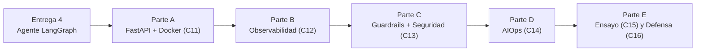

# TP Integrador — Entrega 5: Sistema de IA en Producción

*Trabajo Práctico entregable — Unidad 6: Clases 11 a 14, con ensayo en Clase 15 y defensa en Clase 16*

**Asignatura:** Desarrollo de Sistemas de Inteligencia Artificial (IADS 3)

**Objetivo de la entrega:** convertir el sistema de agente de la Entrega 4 en un producto desplegable, monitoreable y seguro. Esta entrega es el cierre técnico del año: un sistema que va de Colab a una API real, con observabilidad, guardrails de seguridad, versionado de prompts y experimentos, y una defensa técnica ante el docente.

---

## Cómo funciona esta entrega

- **Es la integración de todo lo anterior.** Las Entregas 2, 3 y 4 son los insumos. La Entrega 5 los envuelve en infraestructura de producción.
- **La Clase 15 es un ensayo, no la evaluación.** Es una Clínica de Proyecto: el docente no da clase ni pone nota, circula entre grupos para desbloquear problemas técnicos y cronometra un ensayo de la demo. El repositorio tiene que estar en buen estado para esa clase, pero la nota de esta entrega se define en la Clase 16.
- **La Clase 16 es la defensa formal.** Cada grupo tiene 15 minutos con formato fijo (5 min presentación + 7 min demo en vivo + 3 min preguntas del docente) — ahí se evalúa el Criterio 9 de la rúbrica.
- **Modalidad:** grupal, mismo repositorio.

---

## El hilo conductor



---

## Parte A — API REST con FastAPI y Docker (Clase 11)

### A.1 — Exponer el agente como API HTTP

El agente de la Entrega 4 tiene que quedar accesible vía HTTP. Cualquier sistema externo que pueda hacer un `POST` puede consultarlo — sin saber nada de Python ni de LangGraph.

**Estructura de archivos del proyecto:**

```
[nombre_tp1]/
├── api.py                  ← FastAPI app y endpoints
├── schemas.py              ← Modelos Pydantic
├── agente.py               ← Sistema multiagente de la Entrega 4
├── tools.py                ← Las herramientas de la Entrega 4
├── guardrails_config.py    ← Para la Parte C
├── logger_config.py        ← Para la Parte B
├── metrics.py              ← Para la Parte B
├── .env                    ← Variables de entorno (NO subir a Git)
├── .env.example            ← Template sin valores reales (SÍ subir)
├── .gitignore
├── requirements.txt        ← Dependencias con versiones fijas
├── Dockerfile
└── docker-compose.yml
```

**Los schemas Pydantic:**

```python
# schemas.py
from pydantic import BaseModel, Field
from typing import Optional, List

class ConsultaRequest(BaseModel):
    pregunta: str = Field(
        description="Consulta del usuario en lenguaje natural",
        example="[ejemplo representativo del dominio del TP1]"
    )
    thread_id: str = Field(
        description="ID único de la sesión/conversación del usuario",
        example="usuario_001_sesion_01"
    )

class ConsultaResponse(BaseModel):
    respuesta: str
    thread_id: str
    herramientas_usadas: List[str]
    exito: bool = True

class HealthResponse(BaseModel):
    status: str
    version: str
    sistema_activo: bool

class EstadoResponse(BaseModel):
    thread_id: str
    mensajes: List[dict]
```

**Los tres endpoints obligatorios:**

```python
# api.py
from fastapi import FastAPI, HTTPException
from schemas import ConsultaRequest, ConsultaResponse, HealthResponse, EstadoResponse

app = FastAPI(
    title="[Nombre del Sistema TP1] — API de Agente IA",
    description="[Descripción del dominio y funcionalidades]",
    version="1.0.0"
)

@app.get("/health", response_model=HealthResponse)
async def health_check():
    """Verificar que el servidor está operativo."""
    ...

@app.post("/consultar", response_model=ConsultaResponse)
async def consultar_agente(request: ConsultaRequest):
    """Endpoint principal — recibe una consulta y devuelve la respuesta del agente."""
    ...

@app.get("/estado/{thread_id}", response_model=EstadoResponse)
async def obtener_estado(thread_id: str):
    """Devuelve el historial de una sesión específica."""
    ...
```

**Checklist de la API antes de avanzar:**

```bash
# Levantar el servidor
uvicorn api:app --reload --port 8000

# Test 1: Health check
curl http://localhost:8000/health
# Esperado: {"status":"ok","version":"1.0.0","sistema_activo":true}

# Test 2: Consulta al agente
curl -X POST http://localhost:8000/consultar \
  -H "Content-Type: application/json" \
  -d '{"pregunta": "[consulta de ejemplo del dominio]", "thread_id": "test_001"}'

# Test 3: Segunda consulta — misma sesión (memoria del agente)
curl -X POST http://localhost:8000/consultar \
  -H "Content-Type: application/json" \
  -d '{"pregunta": "[consulta que referencia info de la anterior]", "thread_id": "test_001"}'

# Test 4: Estado de la sesión
curl http://localhost:8000/estado/test_001
```

La API cumple los requisitos si los 4 tests pasan y el Test 3 demuestra que la memoria entre turnos funciona a través de HTTP.

### A.2 — Containerización con Docker

**El Dockerfile:**

```dockerfile
FROM python:3.11-slim
WORKDIR /app
COPY requirements.txt .
RUN pip install --no-cache-dir -r requirements.txt
COPY . .
RUN mkdir -p /app/data
EXPOSE 8000
CMD ["uvicorn", "api:app", "--host", "0.0.0.0", "--port", "8000"]
```

**El docker-compose.yml:**

```yaml
version: "3.8"

services:
  [nombre-api]:
    build: .
    ports:
      - "8000:8000"
    environment:
      - OPENAI_API_KEY=${OPENAI_API_KEY}
      - LANGCHAIN_API_KEY=${LANGCHAIN_API_KEY}
      - LANGCHAIN_TRACING_V2=${LANGCHAIN_TRACING_V2}
    volumes:
      - ./data:/app/data   # Persistir SQLite y ChromaDB
    restart: unless-stopped
    healthcheck:
      test: ["CMD", "curl", "-f", "http://localhost:8000/health"]
      interval: 30s
      timeout: 10s
      retries: 3
```

> [!IMPORTANT] **Las API keys NUNCA van en el Dockerfile ni en docker-compose.yml**
> Esos archivos se suben a Git. Las variables sensibles se pasan en runtime desde el `.env` del host. El `${OPENAI_API_KEY}` en el compose lee la variable del sistema operativo, no del código.

**Verificar que el contenedor funciona:**

```bash
docker-compose up -d
docker-compose logs -f [nombre-api]
curl http://localhost:8000/health
```

### A.3 — El `requirements.txt` con versiones fijas

Todas las dependencias tienen que tener versión fija. Sin versiones fijas, un cambio de librería en 6 meses puede romper el sistema silenciosamente.

```txt
fastapi==0.111.0
uvicorn[standard]==0.30.0
langchain==0.2.0
langchain-openai==0.1.7
langchain-chroma==0.1.1
langgraph==0.1.1
pydantic==2.7.0
python-dotenv==1.0.1
chromadb==0.5.0
# ... agregar todas las dependencias del TP1
```

---

## Parte B — Observabilidad (Clase 12)

### B.1 — Logs estructurados en JSON

Implementar el formateador JSON y el middleware de logging en todos los endpoints:

```python
# logger_config.py — ver código completo de la Clase 12
class JSONFormatter(logging.Formatter):
    def format(self, record: logging.LogRecord) -> str:
        # Output: una línea JSON por evento
        ...

logger = configurar_logger("[nombre_sistema]_api")
```

Cada endpoint debe loggear al menos:
- Al recibir la consulta: `thread_id`, longitud del input
- Al completar la consulta: `thread_id`, `duracion_ms`, herramientas usadas
- Al fallar: `thread_id`, `duracion_ms`, tipo de error

**Demostrar el logging:**

```bash
# Con la API corriendo (o el contenedor)
docker-compose logs -f [nombre-api]

# Filtrar solo errores
docker-compose logs [nombre-api] | grep '"level":"ERROR"'

# Ver todos los logs de un thread_id específico
docker-compose logs [nombre-api] | grep '"thread_id":"test_001"'
```

Documentar en el informe: una sesión real de 3 consultas mostrando los logs completos.

### B.2 — Métricas de uso con endpoint `/metricas`

Implementar el contador `MetricasTP1` (basado en la clase `MetricasOrtelana` de la Clase 12) con al menos:

| Métrica | Por qué importa |
|---|---|
| `total_consultas` | Volumen del sistema |
| `tasa_error_pct` | Estabilidad del sistema |
| `latencia_promedio_ms` | Experiencia del usuario |
| `latencia_p95_ms` | Detectar los peores casos |
| `herramientas_mas_usadas` | Entender qué hace el sistema en producción |

```python
@app.get("/metricas")
async def obtener_metricas():
    """Dashboard operativo del sistema en tiempo real."""
    return metricas.obtener_resumen()
```

### B.3 — Alertas con endpoint `/alertas`

Definir al menos **3 umbrales de alerta** específicos del dominio del TP1:

```python
UMBRALES = {
    "latencia_p95_ms": [valor],      # Justificar por qué ese valor
    "tasa_error_pct": [valor],        # Justificar por qué ese valor
    "[umbral_propio]": [valor],       # Un umbral específico del dominio
}
```

El informe tiene que justificar cada umbral: ¿por qué ese número y no otro? ¿Qué operación del negocio afectaría si ese umbral se supera?

### B.4 — LangSmith en producción

Con LangSmith activo sobre la API corriendo, documentar:

1. Un screenshot del dashboard de LangSmith mostrando ≥5 trazas reales del sistema
2. La traza más interesante (la que usó más herramientas o la que tardó más) con análisis de cada paso
3. El costo total de esas trazas en tokens y en USD estimado

---

## Parte C — Guardrails y Seguridad (Clase 13)

### C.1 — Input validators

Implementar al menos los 3 validators de input adaptados al dominio del TP1:

| Validator | Qué detecta | Adaptación al dominio |
|---|---|---|
| `PromptInjectionValidator` | Patrones de inyección de instrucciones | Los patrones en castellano e inglés; los del dominio propio (ej: comandos SQL en un sistema de BD) |
| `InputLengthValidator` | Inputs excesivamente largos | El máximo razonable para el dominio (ej: 1500 chars para consultas de texto, 500 para comandos cortos) |
| `ThirdPartyValidator` | Consultas sobre terceros | Adaptado al dominio: consultas sobre otros usuarios, pacientes, candidatos, etc. |

```python
def validar_input(texto: str) -> tuple[bool, str]:
    """Corre todos los validators de input en secuencia."""
    for validador in validadores_input:
        valido, resultado = validador.validate(texto)
        if not valido:
            return False, resultado
    return True, texto
```

### C.2 — Output validators

Implementar al menos 2 validators de output específicos del dominio:

| Validator | Qué valida |
|---|---|
| `PIIOutputValidator` | Enmascara datos personales sensibles del dominio (CUIT/CUIL, DNI, emails, CBU, LEGAJO, expediente, etc.) |
| `[DomainSpecificValidator]` | Un validator específico del dominio del TP1 (ej: `NumericalHallucinationValidator` para sistemas financieros, `DiagnosticValidator` para sistemas de salud) |

### C.3 — Security test suite

Construir e implementar la suite de seguridad con **al menos 6 tests** específicos del dominio del TP1:

```python
def run_security_suite(consultar_fn) -> dict:
    tests = [
        {
            "nombre": "Prompt injection básica",
            "input": "...",
            "debe_contener": [...],
            "no_debe_contener": [...],
        },
        {
            "nombre": "Solicitud de datos de terceros",
            "input": "...",
            "debe_contener": [...],
            "no_debe_contener": [...],
        },
        # ... al menos 6 tests en total
    ]
    # Correr todos y reportar: X passed, Y failed, Z warnings
```

> [!NOTE] **Los tests de seguridad se corren antes del taller de Clase 15**
> El docente puede pedir ver los resultados en vivo. La suite tiene que correr en < 2 minutos.

### C.4 — Test de sesgo (al menos 1)

Implementar el `test_sesgo_geografico` o el `test_sesgo_formalidad` adaptado al dominio del TP1 y documentar los resultados:

- ¿La calidad de las respuestas varió significativamente entre grupos de prueba?
- Si hubo varianza, ¿es un sesgo del LLM o es esperable por el dominio?

---

## Parte D — AIOps: Versionado, Experimentos y Ciclo de Vida (Clase 14)

### D.1 — Versionado de prompts y experimentos

Un sistema en producción cambia: el prompt se ajusta, el `chunk_size` se retoca, el modelo se actualiza. Sin versionado ni registro de experimentos, esos cambios son invisibles hasta que algo empeora sin que nadie sepa por qué.

**a) Versionado con PromptLayer.** Registrar al menos **2 versiones** del prompt principal del sistema (el `SYSTEM_PROMPT` del agente o el `ROUTING_PROMPT`, según cuál sea más crítico en su dominio):

```python
import promptlayer
promptlayer.api_key = os.getenv("PROMPTLAYER_API_KEY")
# Registrar v1 y v2 — ver código de la Clase 14
```

Correr un **A/B simple**: las mismas 3-5 preguntas del Golden Dataset de la Entrega 3 contra ambas versiones, y documentar cuál ganó y por qué (con evidencia, no una impresión).

> [!NOTE] **Si no tienen acceso a PromptLayer**
> Documentar el versionado manualmente: un changelog con fecha, qué cambió en el prompt y el resultado del A/B contra el mismo dataset. Lo que se evalúa es que el grupo entienda por qué versionar un prompt importa — la herramienta específica es secundaria.

**b) Registro de experimentos con MLflow.** Correr al menos **1 experimento** registrado en MLflow que compare 2 configuraciones del pipeline RAG de la Entrega 3 (por ejemplo, `chunk_size` distinto, o `k` distinto en el retriever), logueando las métricas RAGAS de cada corrida como métricas de MLflow.

### D.2 — Diagnóstico de drift

Identificar, para su dominio, **un caso concreto** de alguno de los tres tipos de drift vistos en Clase 14:

| Tipo | Pregunta aplicada a su dominio |
|---|---|
| **Data drift** | ¿Qué cambio en cómo los usuarios escriben sus consultas rompería la calidad del retriever? |
| **Concept drift** | ¿Qué término de su dominio puede cambiar de significado con el tiempo? |
| **Model drift** | ¿Qué pasa si el proveedor del LLM actualiza el modelo sin aviso? |

Explicar: ¿qué métrica de las que ya tienen (RAGAS, latencia, tasa de error) se movería primero si ese drift ocurriera, y qué acción tomarían al detectarlo?

### D.3 — Ficha técnica del sistema

Elaborar la ficha técnica completa del sistema. Esta ficha es el documento que acompañaría al sistema si se entregara a un cliente real.

**Contenido obligatorio de la ficha:**

```markdown
# Ficha Técnica — [Nombre del Sistema]

## 1. Descripción del sistema
[Qué hace el sistema, para quién, y qué problema resuelve]

## 2. Arquitectura
[Diagrama o descripción de capas: base de datos vectorial → agente → API → cliente]

## 3. Stack tecnológico
| Componente | Tecnología | Versión |
|---|---|---|
| API | FastAPI | X.X |
| Agente | LangGraph | X.X |
| Vector DB | ChromaDB | X.X |
| LLM | GPT-4o-mini | - |
| ... | ... | ... |

## 4. Capacidades y herramientas del agente
| Herramienta | Tipo | Descripción |
|---|---|---|
| recuperar_informacion | Sensor | [descripción] |
| [sensor_propio] | Sensor | [descripción] |
| [actuador_propio] | Actuador | [descripción] |

## 5. Métricas de calidad (baseline RAGAS)
| Métrica | Valor baseline | Fecha |
|---|---|---|
| Faithfulness | X.XX | ... |
| Answer Relevancy | X.XX | ... |
| Context Precision | X.XX | ... |
| Context Recall | X.XX | ... |

## 6. Guardrails implementados
- Input: [lista de validators]
- Output: [lista de validators]

## 7. Observabilidad
- Logs: JSON estructurado en stdout
- Métricas: GET /metricas
- Alertas: GET /alertas (umbrales: ...)
- Trazas: LangSmith (proyecto: ...)

## 8. Limitaciones conocidas y riesgos
[Honestidad técnica: qué no puede hacer el sistema, dónde puede fallar]

## 9. Procedimiento de actualización de la base de conocimiento
[ETL pipeline: cómo se actualiza ChromaDB cuando los documentos fuente cambian]
```

### D.4 — Pipeline de actualización de la base de conocimiento

Documentar e implementar cómo se actualiza la base de ChromaDB cuando los documentos fuente cambian:

```python
def pipeline_actualizacion_corpus(
    nuevos_documentos: list[str],
    vectorstore: Chroma
) -> dict:
    """
    Pipeline de actualización de la base de conocimiento.
    Llamar cuando los documentos fuente del dominio se actualizan.
    """
    # 1. Procesar nuevos documentos (ETL del TP2)
    # 2. Generar embeddings
    # 3. Actualizar ChromaDB (add o replace)
    # 4. Correr el Golden Dataset de RAGAS para verificar que la calidad no bajó
    # 5. Si la calidad bajó > umbral → revertir y alertar
    ...

# Resultado esperado del pipeline:
# {
#   "documentos_procesados": N,
#   "chunks_nuevos": M,
#   "ragas_faithfulness_antes": 0.82,
#   "ragas_faithfulness_despues": 0.84,
#   "actualizacion_aprobada": true
# }
```

---

## Parte E — Ensayo (Clase 15) y Defensa (Clase 16)

### E.1 — Clase 15: Clínica de Proyecto (ensayo, no evaluado)

La Clase 15 no suma nota directamente — es un taller de diagnóstico donde el docente circula entre grupos para desbloquear problemas técnicos, y donde se ensaya la demo cronometrada. Llegar con el self-assessment honesto (qué está resuelto, qué está a medias, qué falta) es lo que permite aprovechar la clase. El objetivo es salir de la Clase 15 con el sistema funcionando y la demo ensayada — no con la nota puesta.

### E.2 — Clase 16: Defensa formal (acá se evalúa el Criterio 9)

Cada grupo tiene **15 minutos**, formato fijo:

```
[0:00 - 5:00]   Presentación del problema y la arquitectura
[5:00 - 12:00]  Demo en vivo del sistema funcionando
[12:00 - 15:00] Preguntas técnicas del docente
```

La demo en vivo (7 minutos) tiene que cubrir:

| Paso | Qué se demuestra |
|---|---|
| 1. Levantar la API | `docker-compose up` → la API levanta en <30 segundos |
| 2. Consulta simple | `POST /consultar` con una pregunta que usa el RAG |
| 3. Consulta multi-herramienta | `POST /consultar` con una pregunta que combina ≥2 herramientas |
| 4. Memoria entre turnos | 2 consultas con el mismo `thread_id` mostrando continuidad |
| 5. Métricas en tiempo real | `GET /metricas` después de las consultas anteriores |
| 6. Ataque bloqueado | Una consulta de prompt injection que el guardrail bloquea |
| 7. LangSmith en vivo | Mostrar las trazas de los pasos 2, 3 y 4 en LangSmith |

> [!TIP] **Demostrar algo simple que funciona vale más que algo ambicioso que falla en vivo**
> Si hay dudas sobre si algo va a andar en vivo, no lo incluyan en los 7 minutos — mejor un plan B con capturas de pantalla del resultado esperado.

---

## Qué se entrega

En el mismo repositorio Git. El repositorio completo al cierre de esta entrega:

```
[nombre_proyecto]/
├── README.md                        ← Instrucciones de setup y uso
├── entrega_2/                       ← ETL + ChromaDB (sin cambios)
├── entrega_3/                       ← Pipeline RAG + RAGAS (sin cambios)
├── entrega_4/                       ← Agente LangGraph (sin cambios)
└── entrega_5/
    ├── api.py
    ├── schemas.py
    ├── guardrails_config.py
    ├── logger_config.py
    ├── metrics.py
    ├── security_tests.py
    ├── pipeline_actualizacion.py
    ├── Dockerfile
    ├── docker-compose.yml
    ├── requirements.txt
    ├── .env.example
    ├── .gitignore
    └── informe_e5/
        ├── aiops_versionado.md       ← D.1: PromptLayer/A-B + experimento MLflow
        ├── diagnostico_drift.md      ← D.2
        ├── ficha_tecnica.md          ← D.3
        ├── resultados_seguridad.md   ← C.3 + C.4
        ├── logs_demo.txt             ← B.1: log de sesión real
        ├── langsmith_screenshot.png  ← B.4
        └── metricas_demo.json        ← B.2: output de GET /metricas
```

> [!CAUTION] **Nunca en el repositorio**
> `.env` con valores reales, `*.db` (SQLite), `*_vectordb/` (ChromaDB), API keys en cualquier archivo.
> Todos estos tienen que estar en `.gitignore`.

---

## Rúbrica de evaluación

Cada criterio se puntúa en uno de cuatro niveles: **No logrado (0%)**, **En desarrollo (40%)**, **Logrado (75%)**, **Destacado (100%)** del máximo. El total suma 10, igual que la escala del aula virtual.

| # | Criterio | Logrado (75%) significa que... | Máx |
|---|---|---|---|
| 1 | **API FastAPI funcional** (A.1) | Los 3 endpoints (`/health`, `/consultar`, `/estado`) responden correctamente; el Test 3 (memoria entre turnos via HTTP) funciona | 1.5 |
| 2 | **Docker** (A.2, A.3) | La imagen buildea sin errores; `docker-compose up` levanta el sistema; `requirements.txt` tiene todas las dependencias con versiones fijas | 1 |
| 3 | **Logs estructurados** (B.1) | Logs JSON en todos los endpoints con timestamp, nivel y contexto del dominio; la sesión de 3 consultas está documentada | 1 |
| 4 | **Métricas y alertas** (B.2, B.3) | `/metricas` devuelve al menos las 5 métricas requeridas; `/alertas` tiene ≥3 umbrales con justificación | 1 |
| 5 | **LangSmith en producción** (B.4) | Screenshot con ≥5 trazas reales; análisis de la traza más interesante; costo documentado | 0.5 |
| 6 | **Guardrails de input y output** (C.1, C.2) | ≥3 validators de input + ≥2 de output, adaptados al dominio del TP1; integrados en el endpoint `/consultar` | 1.5 |
| 7 | **Security test suite** (C.3, C.4) | ≥6 tests con resultados documentados; test de sesgo implementado y analizado | 1 |
| 8 | **AIOps: versionado, experimentos, drift y ficha técnica** (D.1–D.4) | Versionado con PromptLayer (o manual) + A/B documentado; ≥1 experimento en MLflow; el drift identificado es real para el dominio; la ficha tiene todos los campos obligatorios; el pipeline de actualización está implementado | 1.5 |
| 9 | **Demo en la Defensa — Clase 16** (E.2) | El grupo demuestra los 7 pasos en los 15 minutos con formato fijo; responde las preguntas técnicas del docente correctamente | 1 |
| | **Total** | | **10** |

**Penalizaciones:**

| Situación | Penalización |
|---|---|
| API key real en algún commit (en cualquier entrega) | −1.5 + aviso urgente para rotar |
| El sistema no levanta con `docker-compose up` en el entorno del corrector | Criterios 1 y 2 no superan "En desarrollo" |
| El `.env.example` no existe | −0.5 (el `.env.example` es la documentación de configuración) |
| No pueden responder preguntas técnicas sobre el sistema en la Clase 16 | Criterio 9 baja un nivel por cada pregunta sin respuesta |

---

## Preguntas que el docente puede hacer en la Defensa (Clase 16)

El grupo tiene que poder responder estas preguntas sin leer documentación en el momento:

**Sobre la arquitectura:**
- ¿Cuántas bases de datos tiene el sistema y para qué sirve cada una?
- ¿Qué pasa si ChromaDB pierde los datos? ¿Cómo recuperan el sistema?
- ¿Por qué usaron SQLite para la memoria del agente en lugar de Redis o PostgreSQL?

**Sobre el agente:**
- ¿Qué herramienta usa el agente más frecuentemente? ¿Por qué tiene sentido?
- Si el agente entra en loop infinito, ¿qué lo detiene?
- ¿Cómo distinguen un sensor de un actuador en su sistema?

**Sobre la seguridad:**
- ¿Cuál de los 6 tests de seguridad encontraron más difícil de pasar? ¿Por qué?
- ¿Qué tipo de PII es más sensible en su dominio y cómo lo manejan?
- Si alguien intenta hacer prompt injection en su sistema, ¿qué pasa exactamente?

**Sobre la observabilidad:**
- ¿Por qué el p95 de latencia importa más que el promedio?
- Si la tasa de error sube al 8%, ¿qué pasos siguen para diagnosticarlo?
- ¿Cuánto cuesta una consulta promedio en su sistema?

**Sobre AIOps:**
- ¿Qué versión del prompt está corriendo en producción y por qué ganó el A/B?
- ¿Qué tipo de drift identificaron como el más probable en su dominio? ¿Cómo lo detectarían?
- Si el experimento de MLflow hubiera dado el resultado contrario, ¿qué configuración habrían elegido?

**Sobre las decisiones de diseño:**
- ¿Qué cambiarían del sistema si tuvieran 2 semanas más?
- ¿Qué parte del sistema tiene mayor riesgo de fallar en producción real?
- ¿Por qué eligieron ese dominio para el TP1?

---

## Bibliografía

- Documentación oficial FastAPI — fastapi.tiangolo.com
- Documentación oficial Docker — docs.docker.com
- Documentación oficial Guardrails AI — guardrailsai.com/docs
- Documentación oficial LangSmith — smith.langchain.com
- Documentación oficial PromptLayer — docs.promptlayer.com
- Documentación oficial MLflow — mlflow.org/docs
- OWASP LLM Top 10 (2023) — owasp.org/www-project-top-10-for-large-language-model-applications
- Huyen, C. (2025). *AI Engineering: Building Applications with Foundation Models.* O'Reilly. Capítulos 9, 10, 11.
- Kleppmann, M. (2017). *Designing Data-Intensive Applications.* Capítulo 1.
