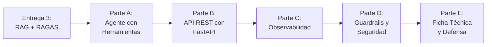

# TP Final — Agente Inteligente en Producción

**Asignatura:** Desarrollo de Sistemas de Inteligencia Artificial (IADS 3)

**Modalidad:** Grupal (mismo repositorio)

**Entrega y defensa:** 16 de noviembre

**Objetivo:** evolucionar el sistema RAG de la Entrega 3 hacia un agente inteligente con LangGraph que decide de forma autónoma qué herramientas usar, recuerda el contexto de la conversación y queda expuesto como una API REST observable y protegida con guardrails. El trabajo cierra con una ficha técnica del sistema y una defensa en vivo.

---

## Flujo de Trabajo del Proyecto

---

## Parte A — Agente con Herramientas (LangGraph)

### A.1 Diseño de Herramientas

El agente debe contar con un mínimo de **3 herramientas**:

| Herramienta                    | Tipo     | Descripción                                                                                              |
| ------------------------------ | -------- | --------------------------------------------------------------------------------------------------------- |
| `recuperar_informacion`      | Sensor   | El retriever de la Entrega 3 convertido en herramienta. Debe conectarse a la misma base ChromaDB.         |
| Herramienta propia del dominio | Sensor   | Lee información sin producir efectos en el sistema.                                                      |
| Herramienta propia del dominio | Actuador | Produce un efecto en el sistema (registrar, generar, crear) y devuelve un identificador de la operación. |

Cada herramienta debe tener un docstring que incluya obligatoriamente: qué hace, una sección **"Usar cuando"**, una sección **"NO usar cuando"**, la descripción de cada parámetro tipado y qué devuelve. El docstring es lo único que el LLM lee para decidir: si es vago, el agente elige mal o inventa parámetros.

Los datos del sensor y el efecto del actuador pueden ser simulados (un diccionario, un archivo JSON, un ID ficticio). Lo que se evalúa es que el agente decida bien cuándo llamarlos y use su resultado.

Ejemplos de referencia:

| Dominio   | Sensor                                   | Actuador                   |
| --------- | ---------------------------------------- | -------------------------- |
| Legal     | Consultar el estado de un expediente     | Registrar una solicitud    |
| Salud     | Verificar un protocolo por diagnóstico  | Generar una derivación    |
| RRHH      | Consultar una posición abierta          | Registrar una postulación |
| Educativo | Buscar los prerrequisitos de una materia | Registrar una inscripción |

### A.2 Grafo ReAct

Construir el agente como un grafo de LangGraph con los siguientes componentes:

1. **Estado:** la lista de mensajes de la conversación.
2. **Nodo agente:** el LLM con las herramientas vinculadas y un System Prompt propio del dominio.
3. **Nodo de herramientas:** ejecuta la herramienta que eligió el LLM.
4. **Condición de salida:** si el LLM pidió una herramienta, se ejecuta y se vuelve al agente; si no, termina.
5. **Límite de iteraciones:** un tope de vueltas que evite loops infinitos.

### A.3 Memoria Persistente

Agregar un checkpointer **SQLite guardado en archivo** para que el agente recuerde el contexto entre turnos de una misma sesión, identificada por un `thread_id`. La memoria debe sobrevivir a un reinicio del sistema.

### A.4 Matriz de Validación del Agente

Ejecutar el agente frente a 4 escenarios y documentar la traza de cada uno (herramienta elegida, parámetros, resultado y respuesta final):

| Tipo de Prueba           | Comportamiento Esperado                                 |
| ------------------------ | ------------------------------------------------------- |
| Consulta de conocimiento | Usa solo `recuperar_informacion`.                     |
| Consulta del dominio     | Usa el sensor propio con los parámetros correctos.     |
| Consulta multi-paso      | Combina al menos 2 herramientas distintas en secuencia. |
| Consulta conversacional  | Responde sin usar ninguna herramienta.                  |

Para la consulta multi-paso, analizar en qué orden se usaron las herramientas, si ese orden tiene sentido y cuántas iteraciones del ciclo se ejecutaron. Si en algún escenario el agente eligió mal, documentar cómo se ajustó el docstring.

---

## Parte B — API REST con FastAPI

### B.1 Endpoints

Exponer el agente mediante tres endpoints, con request y response definidos como modelos Pydantic:

| Endpoint                    | Función                                                                                                                                                       |
| --------------------------- | -------------------------------------------------------------------------------------------------------------------------------------------------------------- |
| `GET /health`             | Estado del servidor, versión y si el sistema está activo.                                                                                                    |
| `POST /consultar`         | Recibe `pregunta` y `thread_id`. Devuelve la respuesta, el `thread_id`, la lista de herramientas usadas **en ese turno** y un indicador de éxito. |
| `GET /estado/{thread_id}` | Devuelve el historial de mensajes de la sesión.                                                                                                               |

### B.2 Memoria vía HTTP

Demostrar, con los requests y las respuestas reales, que la memoria funciona a través de la API:

| Prueba                             | Comportamiento Esperado                                                        |
| ---------------------------------- | ------------------------------------------------------------------------------ |
| Primer turno                       | El usuario aporta un dato (nombre, caso, preferencia).                         |
| Segundo turno, mismo `thread_id` | La respuesta usa el dato del primer turno sin que se repita.                   |
| Consulta de historial              | `/estado` devuelve ambos turnos.                                             |
| Reinicio de la API                 | Después de reiniciar el servidor, `/estado` sigue devolviendo el historial. |

### B.3 Reproducibilidad

El sistema debe poder levantarse en otra máquina siguiendo únicamente el README. Para eso, el proyecto debe incluir:

- `requirements.txt` con **todas** las dependencias en versiones fijas.
- `.env.example` con todas las variables necesarias y sin valores.
- `README.md` con los pasos de instalación, configuración, carga de la base vectorial, arranque de la API y una consulta de ejemplo.
- `.gitignore` que excluya `.env`, las bases SQLite y la carpeta de ChromaDB.

---

## Parte C — Observabilidad

### C.1 Logs Estructurados

Implementar logs en formato JSON (una línea por evento, con timestamp, nivel y mensaje). El endpoint `/consultar` debe registrar como mínimo:

| Evento               | Campos mínimos                                     |
| -------------------- | --------------------------------------------------- |
| Consulta recibida    | `thread_id`, longitud del input                   |
| Consulta completada  | `thread_id`, duración en ms, herramientas usadas |
| Error                | `thread_id`, duración en ms, tipo de error       |
| Bloqueo de guardrail | `thread_id`, validator que bloqueó               |

### C.2 Métricas

Exponer un endpoint `GET /metricas` que devuelva al menos:

- Total de consultas.
- Tasa de error (%).
- Latencia promedio (ms).
- Latencia p95 (ms).
- Herramientas más usadas.
- Consultas bloqueadas por guardrails.

### C.3 LangSmith

Activar la trazabilidad con LangSmith sobre la API en funcionamiento y documentar:

1. Una captura del proyecto con al menos 5 trazas reales generadas a través de la API.
2. La traza más interesante (la que usó más herramientas) con la explicación de cada paso.
3. El costo de esas trazas en tokens y en USD estimado, y el costo promedio por consulta.

---

## Parte D — Guardrails y Seguridad

### D.1 Validators de Input

Implementar al menos 2 validators de input adaptados al dominio:

| Validator         | Qué detecta                                                                                                                   |
| ----------------- | ------------------------------------------------------------------------------------------------------------------------------ |
| Prompt Injection  | Intentos de sobrescribir las instrucciones del sistema, con patrones en castellano y en inglés, más los propios del dominio. |
| Longitud de Input | Entradas excesivamente largas, con un máximo justificado para el dominio.                                                     |

### D.2 Validator de Output

Implementar al menos 1 validator que enmascare los datos personales sensibles del dominio antes de devolver la respuesta (DNI, CUIT/CUIL, email, CBU, legajo, número de historia clínica, según corresponda).

### D.3 Integración en la API

Los validators deben ejecutarse dentro de `/consultar`. Una consulta bloqueada por un validator de input **no debe llegar al LLM**: la API responde con un mensaje de rechazo y el indicador de éxito en falso, registra el bloqueo en los logs y lo suma a las métricas.

### D.4 Suite de Seguridad

Construir una suite automatizada de al menos 4 tests que corran contra la API, reporten cuántos pasaron y cuántos fallaron, y terminen en menos de 2 minutos:

| Tipo de Test                                | Comportamiento Esperado                    |
| ------------------------------------------- | ------------------------------------------ |
| Prompt injection en castellano              | Bloqueada antes de llegar al LLM.          |
| Prompt injection en inglés o por role-play | Bloqueada antes de llegar al LLM.          |
| Input excesivamente largo                   | Rechazado con un mensaje claro.            |
| Respuesta con datos personales              | Los datos sensibles aparecen enmascarados. |

Para cada test que falle, explicar la causa y la corrección propuesta.

---

## Parte E — Ficha Técnica

### E.1 Ficha Técnica

Elaborar la ficha técnica del sistema, como el documento que lo acompañaría si se entregara a un cliente real. Debe contener:

1. Descripción del sistema: qué hace, para quién y qué problema resuelve.
2. Arquitectura: diagrama de capas (base vectorial → herramientas → agente → guardrails → API → cliente).
3. Stack tecnológico con las versiones reales utilizadas.
4. Herramientas del agente, indicando si cada una es sensor o actuador.
5. Métricas de calidad: baseline RAGAS de la Entrega 3 y métricas operativas (latencia p95, tasa de error, costo por consulta).
6. Guardrails implementados.
7. Observabilidad: logs, métricas y proyecto de LangSmith.
8. Limitaciones conocidas y riesgos.

### E.2 Defensa en Vivo (16 de noviembre)

Cada grupo tiene **15 minutos** con formato fijo:

| Tiempo        | Bloque                                              |
| ------------- | --------------------------------------------------- |
| 0:00 – 4:00   | Problema del dominio y arquitectura del sistema.    |
| 4:00 – 11:00  | Demo en vivo.                                       |
| 11:00 – 15:00 | Preguntas técnicas del docente a cualquier integrante. |

La demo en vivo debe cubrir:

| Paso                         | Qué se demuestra                                                   |
| ---------------------------- | ------------------------------------------------------------------ |
| 1. Levantar la API           | La API arranca siguiendo el README y `/health` responde.            |
| 2. Consulta de conocimiento  | `POST /consultar` que usa `recuperar_informacion`.                 |
| 3. Consulta multi-paso       | `POST /consultar` que combina al menos 2 herramientas.             |
| 4. Memoria entre turnos      | Dos consultas con el mismo `thread_id` y `/estado` con el historial. |
| 5. Métricas                  | `GET /metricas` con los valores de las consultas anteriores.        |
| 6. Ataque bloqueado          | Un prompt injection bloqueado y su registro en los logs.           |
| 7. LangSmith                 | Las trazas de los pasos 2, 3 y 4.                                   |

Cualquier integrante debe poder explicar cualquier parte del sistema, no solo la que implementó.

---

## Qué se Entrega

El link al mismo repositorio público, con la carpeta `tp_final/` que contenga:

1. **Código del agente** (`agente.py` o equivalente): herramientas, grafo ReAct y checkpointer (Parte A).
2. **Código de la API** (`api.py`, `schemas.py`): endpoints, logs, métricas y guardrails integrados (Partes B, C y D).
3. **Suite de seguridad** (`security_tests.py`): ejecutable desde la terminal (D.4).
4. **Archivos de reproducibilidad:** `requirements.txt`, `.env.example`, `README.md` y `.gitignore` (B.3).
5. **Informe** (`informe.md`) con:
   - Matriz de validación del agente con sus trazas y el análisis multi-paso (A.4).
   - Evidencia de memoria vía HTTP: requests y respuestas reales (B.2).
   - Extracto de logs reales y salida de `/metricas` (C.1, C.2).
   - Captura de LangSmith, análisis de la traza más interesante y costos (C.3).
   - Resultados de la suite de seguridad, con la causa y corrección de cada test fallido (D.4).
6. **Ficha técnica** (`ficha_tecnica.md`) (E.1).

**Nunca en el repositorio:** `.env` con valores reales, bases SQLite, carpeta de ChromaDB ni API keys en ningún archivo.

---

## Rúbrica de Evaluación

Cada criterio se puntúa en cuatro niveles: **No logrado (0 %)**, **En desarrollo (40 %)**, **Logrado (75 %)** y **Destacado (100 %)** del máximo.

| #  | Criterio                                          | Logrado significa que...                                                                                         | Máx    |
| -- | ------------------------------------------------- | ---------------------------------------------------------------------------------------------------------------- | ------ |
| 1  | **Herramientas y docstrings** (A.1)               | ≥3 herramientas (retriever + sensor + actuador) con docstrings completos: "Usar cuando", "NO usar cuando", parámetros y retorno. | 1      |
| 2  | **Grafo ReAct y matriz de validación** (A.2, A.4) | El grafo tiene los 5 componentes; los 4 escenarios se comportan como se espera y están documentados con su traza.  | 1.5    |
| 3  | **Memoria persistente** (A.3, B.2)                | Checkpointer SQLite en archivo; los 4 pasos de la prueba de memoria vía HTTP funcionan, incluido el reinicio.      | 1      |
| 4  | **API REST** (B.1)                                | Los 3 endpoints responden con modelos Pydantic; `/consultar` informa las herramientas usadas en el turno.         | 1      |
| 5  | **Reproducibilidad** (B.3)                        | El sistema levanta en otra máquina siguiendo solo el README; versiones fijas y `.gitignore` correcto.             | 0.5    |
| 6  | **Logs y métricas** (C.1, C.2)                    | Logs JSON con los 4 eventos y sus campos; `/metricas` devuelve las 6 métricas con valores reales.                  | 1      |
| 7  | **LangSmith** (C.3)                               | ≥5 trazas reales vía API; análisis paso a paso de la traza más interesante; costo total y por consulta.           | 0.5    |
| 8  | **Guardrails integrados** (D.1–D.3)               | ≥2 validators de input y ≥1 de output adaptados al dominio; lo bloqueado no llega al LLM y queda en logs y métricas. | 1      |
| 9  | **Suite de seguridad** (D.4)                      | ≥4 tests automáticos contra la API, con reporte de resultados y análisis honesto de los fallidos.                  | 0.5    |
| 10 | **Ficha técnica** (E.1)                           | Los 8 apartados completos, con datos reales del sistema y limitaciones concretas.                                  | 1      |
| 11 | **Defensa en vivo** (E.2)                         | Los 7 pasos de la demo se completan; el grupo responde las preguntas técnicas básicas e intermedias.             | 1      |
|    | **Total**                                         |                                                                                                                  | **10** |

**Penalizaciones:**

| Situación                                                  | Penalización                                          |
| ---------------------------------------------------------- | ----------------------------------------------------- |
| API key real en cualquier commit del repositorio           | −1.5 puntos y aviso urgente para rotar la clave.      |
| Falta el `.env.example`                                    | −0.5 puntos.                                          |
| La API no levanta siguiendo el README                      | Los criterios 4 y 5 no superan "En desarrollo".       |
| Un integrante no puede responder sobre una parte del sistema | El criterio 11 baja un nivel para el grupo.         |
