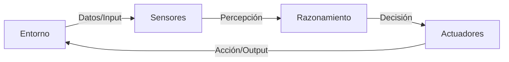
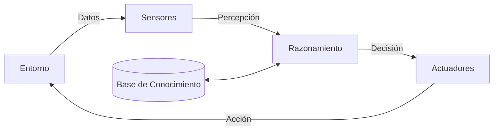

# Clase 1: Presentación y Arquitectura de Sistemas con IA

**Asignatura:** Desarrollo de Sistemas de Inteligencia Artificial

**Objetivo Técnico:** Comprender la transición desde los modelos fundacionales aislados hacia las arquitecturas sistémicas modernas, usando el marco PEAS extendido y experimentando en vivo los límites de los modelos comerciales.

> **Para quienes vienen de las Microcredenciales**
> En la Microcredencial #2 vieron cómo identificar oportunidades y diseñar productos con IA. En la Microcredencial #3 trabajaron con agentes y orquestación de forma conceptual. En esta clase formalizamos eso con precisión técnica: qué es exactamente un agente, cómo se estructura una arquitectura real y cuál es la diferencia entre diseñar un producto y construir la infraestructura que lo sostiene. El "qué" ya lo conocen — hoy construimos el "cómo se hace por dentro".

---

## Planificación de la Clase (4 horas)

| Bloque             | Duración | Contenido                                                      |
| ------------------ | --------- | -------------------------------------------------------------- |
| **Bloque 1** | 20 min    | Presentación de la materia y el caso Ortelana Textil          |
| **Bloque 2** | 25 min    | Taller express: experimentar la alucinación en vivo           |
| **Bloque 3** | 45 min    | Teoría de Agentes, PEAS extendido y arquitectura moderna      |
| **Bloque 4** | 90 min    | Taller práctico: "La Lente del Arquitecto" en Ortelana Textil |
| **Cierre**   | 20 min    | Resumen, material asincrónico y conexión con Clase 2         |

---

## Bloque 1: Presentación y Contexto (20 min)

### El cambio de chip

Bienvenidos. Esta materia es el espacio donde todo lo que aprendieron antes sobre Ciencia de Datos y Machine Learning se une para crear productos reales. No nos quedamos en el laboratorio — construimos sistemas que interactúan con el mundo.

**El objetivo del cuatrimestre:** pasar de ser quien *entrena modelos* a ser quien *construye arquitecturas*. Del notebook a la implementación.

A lo largo de las 16 clases trabajaremos con un objetivo claro: el **Proyecto Integrador** — una solución funcional que usa APIs, RAG, agentes inteligentes y orquestación. Todo lo que vemos hoy es el cimiento de ese proyecto.

**Tres conceptos que van a escuchar todo el cuatrimestre:**

- **Arquitectura Sistémica:** no es solo código, es cómo los componentes (IA, bases de datos, APIs) se comunican de forma robusta y escalable.
- **Agente Inteligente:** no es un programa que "corre", es una entidad autónoma que "actúa" basándose en lo que "ve" en su entorno.
- **SOTA (State of the Art):** no vemos lo que funcionaba hace 5 años — trabajamos con lo que OpenAI, Google y Anthropic están lanzando hoy.

---

### El caso del cuatrimestre: Ortelana Textil

Durante toda la materia vamos a trabajar con **Ortelana Textil**: una firma tradicional de fabricación y distribución de indumentaria al por mayor que está en plena digitalización postpandemia.

**El problema:** el aumento explosivo de canales como e-commerce y WhatsApp generó fricciones operativas graves. Los nuevos distribuidores envían documentación fiscal, capturas de pantalla y consultas en texto libre totalmente desestructuradas. El equipo de administración pasa la mayor parte de su jornada transcribiendo datos manualmente a un sistema de gestión antiguo y validando si califican para compras a gran escala.

**Por qué este caso:** tiene todos los ingredientes de un sistema real — datos desestructurados, reglas de negocio complejas, sistemas legados, y un dolor claro que la IA puede resolver. Cada clase vamos a agregar una capa de solución.

> **Pregunta para abrir el debate**
> ¿Qué parte de ese proceso creen que podría automatizarse primero? ¿La que tiene más volumen, la más compleja, o la que tarda más?
>
> *Dejar que respondan — esto introduce los tres tipos de puntos de dolor que vemos en Clase 2.*

---

## Bloque 2: Taller Express — "El Proveedor Enojado" (25 min)

### Consigna

Antes de explicar nada, vamos a experimentar el problema central de la materia.

**En grupos de 3, tienen 15 minutos para:**

Abrir ChatGPT o Gemini (la versión web gratuita) e intentar que el modelo responda este mensaje como si fuera el sistema de atención de Ortelana Textil:

```
"Buen día. Soy distribuidor mayorista de Rosario. Mando mis datos:
CUIT 20-12345678-9, inscripto en ingresos brutos ARCA categoría B,
facturación anual $180M. Quiero saber si califico para cuenta
corriente a 60 días según la normativa interna de Ortelana.
Adjunto certificado de habilitación municipal."
```

**Lo que tienen que lograr:** que el modelo diga si el distribuidor califica o no, citando la normativa interna de Ortelana.

**Lo que va a pasar:** el modelo va a inventar una normativa que no existe, o va a dar una respuesta genérica que suena profesional pero es completamente falsa.

**Documentar:** copiar la respuesta del modelo y marcar qué parte es inventada.

---

### Puesta en común (10 min)

Cada grupo comparte su resultado. Preguntas guía:

- ¿El modelo inventó normativas? ¿Con qué nivel de confianza las presentó?
- ¿Alguien logró que el modelo dijera "no sé"?
- ¿Qué le faltó al modelo para responder correctamente?

> **La conclusión que tiene que surgir del grupo**
> El modelo no falló porque sea "malo". Falló porque no tiene acceso a la normativa interna de Ortelana. Su naturaleza es predecir la siguiente palabra más probable — no "decir la verdad". Cuando no tiene los datos reales, inventa algo que *suena* correcto. Eso se llama **alucinación**, y es el problema central que vamos a resolver durante todo el cuatrimestre con arquitecturas RAG y grounding.

---

## Bloque 3: Teoría — Del Modelo al Sistema (45 min)

### Modelo aislado vs. Arquitectura sistémica

El taller mostró el límite de un modelo sin sistema. Ahora formalizamos la diferencia.

**El Modelo Aislado:**
Es el archivo `.pkl` o `.h5` que vive en un Jupyter Notebook. Es un "cerebro en un frasco": hace una predicción, pero no tiene contexto ni capacidad de actuar por sí mismo.

*Ejemplo: modelo que detecta fraudes con 99% de precisión pero tarda 10 segundos en responder y no está conectado a la pasarela de pagos. ¿Es útil?*

> **Pregunta #1**
> Si ese modelo de fraudes tarda 10 segundos y no puede bloquear el pago... ¿tenemos un sistema inteligente útil?
>
> **Análisis:** No. La utilidad no se mide solo por la precisión del modelo, sino por su capacidad de **acción en tiempo real**. Si no puede ejecutar la acción correcta en el momento justo, el sistema falló en su propósito.

**La Arquitectura Sistémica:**
Es el ecosistema que rodea al modelo: bases de datos, APIs, orquestadores, reglas de negocio. El modelo es una pieza — no el sistema completo.

*Ejemplo real: sistema hospitalario que recibe la imagen → la procesa con el modelo → alerta al médico si el resultado es crítico → agenda una cita de seguimiento. El modelo es solo el paso 2.*

---

### La Teoría de Agentes (Russell & Norvig)

> **Referencia**
> Russell, S. J., & Norvig, P. (2021). *Artificial Intelligence: A Modern Approach* (4th ed.). Pearson. Capítulo 2.

Un **agente inteligente** es cualquier entidad que percibe su entorno mediante sensores y actúa sobre él mediante actuadores de forma racional para maximizar una función objetivo.

#### El Ciclo del Agente



**Ejemplo clásico — El Termostato Inteligente:**

- **Entorno:** El aire de la habitación
- **Sensores:** Termómetro digital
- **Razonamiento:** Si temperatura < 18°C → encender
- **Actuador:** El interruptor de la caldera

*Nota: acá no hay Base de Conocimiento — solo una regla fija. Eso lo diferencia de un sistema moderno.*

---

### El PEAS extendido — Los 5 pilares

Para sistemas modernos de IA, el PEAS clásico no alcanza. Necesitamos un 5to pilar:

| Pilar                          | Pregunta que responde          | En Ortelana Textil                                |
| ------------------------------ | ------------------------------ | ------------------------------------------------- |
| **Performance**          | ¿Cómo medimos el éxito?     | Tiempo de alta de cuenta mayorista < 5 min        |
| **Environment**          | ¿Dónde opera el sistema?     | ERP legado, correo IMAP, WhatsApp, formulario web |
| **Actuators**            | ¿Qué puede hacer el sistema? | Alta en ERP, envío de mail, generación de JSON  |
| **Sensors**              | ¿Qué información recibe?    | Correos, PDFs, mensajes WhatsApp, HTTP requests   |
| **Base de Conocimiento** | ¿Qué sabe el sistema?        | BD SQL, PDFs de normativa, base vectorial         |

#### El Ciclo con Base de Conocimiento



**¿Por qué el 5to pilar?** Porque en la era de los LLMs, el modelo tiene la capacidad de razonar, pero la Base de Conocimiento es la que le da el contexto real para no inventar. Eso es exactamente lo que le faltó al modelo en el taller express: acceso a la normativa interna de Ortelana.

> **Pregunta #2**
> En el taller, ¿qué componente del PEAS estaba faltando cuando el modelo inventó la normativa?
>
> **Análisis:** La **Base de Conocimiento**. El modelo tenía Sensores (el texto del distribuidor), Razonamiento (el LLM) y Actuadores (la respuesta en pantalla). Pero no tenía acceso a la normativa real de Ortelana — entonces inventó una.

---

### Los bloques modernos de una arquitectura de IA

> **Hoja de ruta**
> Cada uno de estos bloques tiene su propia clase dedicada. Hoy los presentamos para tener el mapa completo.

**1. Modelos Fundacionales y APIs (Clases 3)**
Ya no siempre entrenamos desde cero. Consumimos modelos como GPT-4, Claude o Gemini vía API. Es como comprar un motor en lugar de fundirlo.

**2. Grounding — Anclaje al mundo real (Clases 4-8)**
La técnica para evitar alucinaciones. Darle al modelo datos reales y actualizados para que sus respuestas sean veraces. Sin grounding, el modelo es como un experto que perdió la memoria y empieza a inventar datos que suenan creíbles.

**3. Orquestadores — LangChain (Clases 6-10)**
El "pegamento" de la lógica. Manejan el flujo entre el modelo, la base de conocimiento y los actuadores. Deciden qué herramienta usar en cada paso.

**4. APIs y Microservicios (Clase 11)**
Cómo exponemos nuestra inteligencia al mundo. La IA como un componente más de un ecosistema mayor.

> **Pregunta #3**
> ¿Por qué un LLM inventa hechos con tanta seguridad? ¿Es un fallo del modelo o del sistema?
>
> **Análisis:** Es un fallo de **Grounding**. El modelo fue entrenado con datos pasados y su naturaleza es predecir la siguiente palabra más probable, no "decir la verdad". El sistema es el que debe proveerle los datos reales para que no tenga que inventar.

---

### Representación del conocimiento — Embeddings

La pregunta natural es: ¿cómo guarda el sistema esa Base de Conocimiento para que el LLM pueda consultarla?

La respuesta son los **embeddings**: representaciones numéricas de texto en un espacio de múltiples dimensiones. Textos con significados similares producen vectores cercanos.

**Para visualizarlo en 2 dimensiones:**

| Concepto         | Tamaño (X) | Peligrosidad (Y) | Vector          |
| ---------------- | ----------- | ---------------- | --------------- |
| **Gatito** | 0.1         | 0.1              | `[0.1, 0.1]`  |
| **Tigre**  | 0.8         | 0.9              | `[0.8, 0.9]`  |
| **León**  | 0.9         | 0.95             | `[0.9, 0.95]` |

Si alguien pregunta por algo "grande y peligroso", el sistema busca vectores cercanos a `[0.9, 0.9]` — encuentra León y Tigre, no Gatito.

> **Pregunta #4**
> En SQL, si busco "vivienda" no encuentro "hogar". ¿Cómo resuelve esto una base vectorial?
>
> **Análisis:** "Vivienda" y "hogar" tienen vectores muy cercanos porque comparten contexto semántico en el entrenamiento. La base vectorial devuelve resultados por cercanía matemática, no por coincidencia exacta de palabras. Eso es lo que hace posible el RAG.

> **Conexión con el taller express**
> Si el sistema de Ortelana tuviera la normativa interna convertida en embeddings y guardada en una base vectorial, cuando llega la consulta del distribuidor el sistema recuperaría los artículos relevantes y se los pasaría al LLM como contexto. El LLM respondería con la normativa real — no inventada. Eso es RAG. Lo construimos en la Clase 6.

---

## Bloque 4: Taller Práctico — "La Lente del Arquitecto" (90 min)

### Consigna

En grupos de arquitectura, modelar el PEAS extendido del agente de Onboarding automatizado para Ortelana Textil. Documentar en formato Markdown.

**El problema a resolver:** Los nuevos distribuidores envían documentación desestructurada por múltiples canales. El equipo de administración valida manualmente si califican para cuenta corriente. Ese proceso tarda días y tiene errores.

**El agente que van a diseñar:** automatiza la recepción, validación y respuesta a solicitudes de alta de cuentas mayoristas.

---

### Template de entregable (completar en Markdown)

```markdown
## PEAS — Agente de Onboarding de Ortelana Textil

### Performance (¿Cómo medimos el éxito?)
- Métrica 1: ...
- Métrica 2: ...

### Environment (¿Dónde opera?)
- Sistemas con los que interactúa: ...
- Restricciones del entorno: ...

### Actuators (¿Qué puede hacer?)
- Acción 1: ...
- Acción 2: ...

### Sensors (¿Qué información recibe?)
- Fuente 1: ...
- Fuente 2: ...

### Base de Conocimiento (¿Qué sabe?)
- Dato estructurado: ...
- Dato no estructurado: ...

### Decisión técnica preliminar
- ¿Qué partes serían deterministas (reglas/SQL)?
- ¿Qué partes necesitarían LLM?
```

---

### Resolución esperada

> **Para el docente — usar esto para guiar la puesta en común**

**Performance:**

- Tiempo de alta de cuentas mayoristas: de 72 horas hábiles a menos de 5 minutos.
- Tasa de falsos positivos en verificaciones de crédito: < 1.5%.
- Reducción de carga manual del equipo de administración: > 80%.

**Environment:**

- Sistema de gestión/ERP legado (REST API rígida).
- Servidores de correo corporativo IMAP.
- API de WhatsApp Business.
- Formulario web de inscripción.
- Normativas internas en PDF dispersas en Drive.

**Actuators:**

- Peticiones HTTP al ERP para dar de alta registros.
- Despacho automático de mails de aprobación/rechazo.
- Generación de cotizaciones.
- Generación de JSON estructurado para interoperabilidad.
- Notificaciones al equipo de administración para casos borderline.

**Sensors:**

- Correos entrantes de distribuidores.
- Archivos adjuntos de inscripción (PDF, PNG).
- Mensajes de WhatsApp.
- Peticiones HTTP del formulario web.

**Base de Conocimiento:**

- Registro de clientes y catálogo de productos.
- Historial de cuentas corrientes en BD SQL corporativa.
- Base vectorial con reglamentos comerciales y fiscales (a construir en Clases 4-6).
- Normativas internas de calidad y políticas comerciales en PDF.

**Decisión técnica:**

- Verificación de CUIT y categoría fiscal → determinista (SQL + API ARCA).
- Validación contra normativa interna → LLM con RAG sobre los PDFs.
- Redacción de la respuesta al distribuidor → LLM.

## Cierre y Material Asincrónico (20 min)

### Resumen de la clase

- Un **modelo aislado** predice. Un **sistema inteligente** actúa.
- El **PEAS extendido** es la ficha técnica de cualquier agente: Performance, Environment, Actuators, Sensors + Base de Conocimiento.
- La **alucinación** no es un bug del modelo — es la ausencia de grounding en el sistema.
- Los **embeddings** son la forma en que el sistema representa conocimiento para que el LLM pueda consultarlo sin inventar.

---

### Material asincrónico — Entre Clase 1 y Clase 2

> **La Clase 2 arranca asumiendo que completaron esto**

**Actividad 1 — Anatomía del Token:**
Instalar la librería `tiktoken` de OpenAI en Colab y analizar cuántos tokens consume una consulta típica de un distribuidor de Ortelana en español vs. en inglés. Documentar el resultado y reflexionar: ¿cómo impacta eso en el costo por consulta del sistema?

```python
!pip install tiktoken
import tiktoken

enc = tiktoken.encoding_for_model("gpt-4o")
texto = "Buen día. Soy distribuidor mayorista de Rosario..."
tokens = enc.encode(texto)
print(f"Tokens: {len(tokens)}")
```

**Actividad 2 — Laboratorio "El Prompt Roto":**
En ChatGPT Playground o Claude, diseñar un System Prompt que fuerce al modelo a responder ÚNICAMENTE en JSON plano con los datos del distribuidor — sin texto explicativo, sin "Aquí tienes el JSON:".

Documentar al menos **dos casos donde el modelo rompa el formato** ante inputs ambiguos o maliciosos. Guardar los enlaces o capturas.

*Criterio: en Clase 2 arrancamos debatiendo estos resultados como punto de partida para implementar validadores (Pydantic).*

**Actividad 3 — Lectura optativa:**
Vaswani, A., et al. (2017). *Attention Is All You Need.* — leer el abstract y la introducción. No hace falta entender la matemática; el objetivo es entender por qué el mecanismo de atención cambió todo.

---

### Conexión con Clase 2

En la Clase 2 vamos a ver el dilema central de la arquitectura: **¿cuándo usar reglas deterministas y cuándo usar un LLM?** El laboratorio "El Prompt Roto" que hacen esta semana es exactamente el punto de partida de esa discusión.

---

## Bibliografía de la Clase

- **Russell, S., & Norvig, P. (2021).** *Artificial Intelligence: A Modern Approach.* 4th Ed. Pearson. Capítulos 1 y 2.
- **Huyen, C. (2025).** *AI Engineering: Building Applications with Foundation Models.* O'Reilly. Capítulo 1.
- **Vaswani, A., et al. (2017).** *Attention Is All You Need.* NeurIPS.
- **Documentación de LangChain** — python.langchain.com (Introducción a conceptos).
