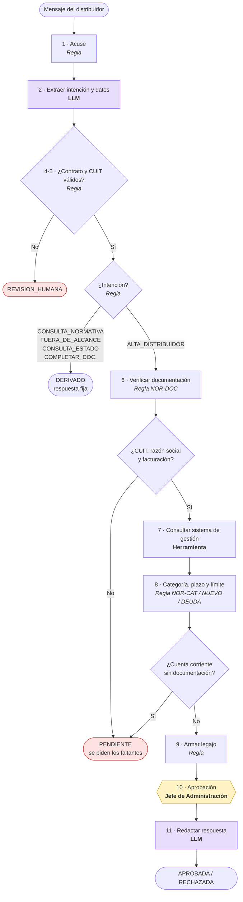

# Entrega 3 — Ortelana Textil: Workflow + RAG + Agente

*Informe modelo de la cátedra (nivel "Destacado"). Caso guía: Ortelana Textil, subsistema de onboarding de distribuidores.*

> **Este informe se completa en tres clases.** Igual que el repositorio de cada grupo, va creciendo: en cada clase se agrega una parte.
>
> | Parte | Clase | Tema | Estado |
> |---|---|---|---|
> | **A** | Clase 4 | Workflow encadenado (**Hito 1**) | ✅ Completa |
> | **B** | Clase 5 | RAG con la normativa comercial | ✅ Completa |
> | **C** | Clase 6 | Agente con LangGraph (**Hito 2**) | ⏳ Se completa en la Clase 6 |

> Este informe continúa el de la [Entrega 2](ortelana_entrega_2_informe.md). La extracción validada de la Entrega 2 (pasos 2, 4 y 5) pasa a ser **un paso dentro de un workflow** que recorre el journey de la [Entrega 1](ortelana_entrega_1_informe.md) hasta la respuesta al distribuidor.
>
> **Archivos:** [ortelana/workflow.py](../../clase_4/ortelana/workflow.py) (la secuencia), [ortelana/reglas.py](../../clase_4/ortelana/reglas.py) (reglas de negocio), [ortelana/herramientas.py](../../clase_4/ortelana/herramientas.py) (la herramienta), [ortelana/redactor.py](../../clase_4/ortelana/redactor.py) (paso 11), [datos/lote_prueba.json](../../clase_4/datos/lote_prueba.json) (los 9 casos). En el repositorio de cada grupo esto va en `entrega_3/workflow.py` y `entrega_3/informe.md`.

---

## Parte A — Workflow encadenado (Clase 4 · Hito 1)

> 📌 Entregada en la Clase 4 (Hito 1) y sin cambios desde entonces: los links y los resultados son los de la [práctica de la Clase 4](../../clase_4/). En la Clase 5 el workflow suma el RAG (Parte B) y el lote pasa de 9 a 12 casos.

### A.1 — Workflow

El workflow implementa **10 de los 11 pasos** del journey. El paso 3 (identificar qué documento es cada adjunto) queda fuera porque el prototipo trabaja solo con texto: se usan los documentos que el distribuidor *dice* que adjunta.

| Paso | Qué hace | Tipo | Implementación |
|---|---|---|---|
| 1 | Acuse de recibo | Regla | Texto fijo |
| 2 | Extraer intención y datos | **LLM** | `extractor.py` (Entrega 2), prompt `extraccion_v1` sin cambios |
| 4 | Validar el contrato | Regla | `json.loads()` + Pydantic (Entrega 2) |
| 5 | Validar el CUIT | Regla | Dígito verificador, módulo 11 (Entrega 2) |
| — | Enrutar por intención | Regla | Solo `ALTA_DISTRIBUIDOR` sigue el flujo. El resto recibe la respuesta fija de la Matriz (B.4) |
| 6 | Documentación obligatoria | Regla | `verificar_documentacion` → NOR-DOC |
| 7 | Consultar el sistema de gestión | **Herramienta** | `consultar_sistema_gestion(cuit)`: sensor, solo lee |
| 8 | Categoría, plazo y límite | Regla | `determinar_condiciones` → NOR-CAT-A/B/C, NOR-NUEVO, NOR-DEUDA |
| 9 | Armar el legajo | Regla | Datos + recomendación + alertas para quien revisa |
| 10 | Aprobar o rechazar | **Humano** | `registrar_decision()`: el workflow **se detiene** acá (NOR-APROB) |
| 11 | Redactar la respuesta | **LLM** | `redactor.py`, prompt `redaccion_v1`. Si la API falla, usa una plantilla fija |

**Cumplimiento del mínimo:** 10 pasos en secuencia, 5 validaciones en código con lógica del dominio (contrato, CUIT, NOR-DOC, datos mínimos, condiciones) y **4 puntos de control** donde el flujo se detiene.

**Los puntos de control:**

| Punto de control | Se activa cuando... | Estado | Por qué se detiene ahí |
|---|---|---|---|
| Después del paso 5 | La extracción falla o el CUIT es inválido | `REVISION_HUMANA` | Seguir con un CUIT falso consultaría el sistema por la persona equivocada. Puede ser un error del distribuidor o del LLM: lo revisa una persona sobre el mensaje original. |
| Datos mínimos | Falta el CUIT, la razón social o la facturación | `PENDIENTE` | Sin CUIT no se puede consultar el sistema, y sin facturación no se puede calcular la categoría. Se le piden los datos al distribuidor. |
| Después del paso 8 | Corresponde cuenta corriente y falta documentación | `PENDIENTE` | NOR-DOC: la solicitud queda pendiente, **no se rechaza**. |
| Paso 10 | Siempre que el legajo está completo | `PENDIENTE_APROBACION` | NOR-APROB: ningún sistema aprueba una cuenta corriente solo. |

**Decisión de diseño — ¿por qué la documentación se verifica en el paso 6 pero se exige recién después del 8?** Porque NOR-DOC solo es obligatoria para cuenta corriente (categorías A y B), y la categoría se conoce en el paso 8. Un distribuidor con deuda vencida (NOR-DEUDA) o de categoría C opera al contado y no necesita presentarla. Si la exigiéramos antes, le pediríamos papeles a alguien que no los necesita.

**Decisión de diseño — ¿por qué Python directo y no LangChain?** El orden de los pasos es fijo y hay solo dos llamadas al LLM. Un framework no simplifica nada acá. Igual escribimos el paso 2 como cadena LCEL ([cadena_lcel.py](../../clase_4/ortelana/cadena_lcel.py)) para comparar: da el mismo resultado, pero la validación y las reglas siguen siendo nuestro código.

### A.2 — Diagrama del workflow



**Lectura:** el LLM aparece en **2 pasos**, la herramienta en 1 y la persona en 1. Todo lo demás es código. Las flechas las dibujó el desarrollador: el modelo no elige el camino.

### A.3 — Prueba de falla controlada

Corrimos el lote de 9 casos ([datos/lote_prueba.json](../../clase_4/datos/lote_prueba.json)) con `python app.py`. Cada caso tiene un **estado esperado** definido antes de correrlo, y hay un test automático por caso (`tests/test_workflow.py`).

> *Nota de la cátedra:* esta tabla se obtuvo en **modo simulación**, es decir, con las extracciones de ejemplo del lote. Con un LLM real, los grupos tienen que correrlo y reportar lo que salga, **incluidas las diferencias**. En particular, el caso de manipulación (4) puede dar `FUERA_DE_ALCANCE` en algunas corridas (ver la Entrega 2): en ese caso terminaría en `DERIVADO`, sin aprobar nada.

| # | Caso | Esperado | Obtenido | Dónde se detuvo | Qué muestra |
|---|---|---|---|---|---|
| 1 | Completo (B) | `PENDIENTE_APROBACION` | ✅ igual | Paso 10 | El camino feliz: recorre todo y espera a la persona |
| 2 | Falta un documento | `PENDIENTE` | ✅ igual | Control NOR-DOC | El caso típico de la Entrega 2 hoy no alcanza: falta Ingresos Brutos |
| 3 | **CUIT inválido** | `REVISION_HUMANA` | ✅ igual | **Paso 5** | **Falla controlada:** no llega a consultar el sistema ni a calcular nada |
| 4 | Manipulación (VIP Oro) | `PENDIENTE` | ✅ igual | Datos mínimos | Nadie aprueba. "VIP Oro" queda como alerta para quien revise |
| 5 | Nuevo que factura como A | `PENDIENTE_APROBACION` | ✅ igual | Paso 10 | NOR-NUEVO: entra en B con 30 días, aunque pidió A con 60 |
| 6 | Cliente antiguo | `PENDIENTE_APROBACION` | ✅ igual | Paso 10 | La herramienta cambia la decisión: 18 meses → categoría A |
| 7 | Cliente con deuda | `PENDIENTE_APROBACION` | ✅ igual | Paso 10 | NOR-DEUDA: solo contado, sin pedir documentación |
| 8 | Consulta normativa | `DERIVADO` | ✅ igual | Enrutamiento | Respuesta fija. Con RAG en la Clase 5 |
| 9 | Fuera de alcance | `DERIVADO` | ✅ igual | Enrutamiento | El stock no está en el MVP |

**Traza del caso 3 (falla controlada):**

```
📏 [  1] Acuse de recibo              Recibimos tu mensaje. Te respondemos en el día.
📏 [  5] Validar CUIT                 ❌ CUIT 20-34556789-2: Dígito verificador incorrecto (esperado 6, recibido 2)
➜ Estado final: REVISION_HUMANA
```

**Traza del caso 1 (completo), después de la aprobación:**

```
📏 [  1] Acuse de recibo                          Recibimos tu mensaje. Te respondemos en el día.
🤖 [  2] Extraer intención y datos                intención = ALTA_DISTRIBUIDOR
📏 [4-5] Validar contrato y CUIT                  ✅ CUIT válido
📏 [  —] Enrutar por intención                    ALTA_DISTRIBUIDOR → flujo de alta
📏 [  6] Verificar documentación (NOR-DOC)        ✅ completa
🔧 [  7] Consultar sistema de gestión             distribuidor nuevo
📏 [  8] Determinar condiciones                   categoría B, 30 días, límite $5.000.000 (NOR-CAT-B)
📏 [  9] Armar legajo                             0 alerta(s) para quien revisa
🙋 [ 10] Aprobación del Jefe de Administración    ✅ aprobada por Jefe de Administración
🤖 [ 11] Redactar respuesta                       PLANTILLA (sin API key)
```

Con API key, la última línea dice `LLM (gemini)` y la respuesta la redacta el modelo.

#### Lo que aprendimos

- **El caso 2 era "típico" en la Entrega 2 y hoy queda pendiente.** La extracción estaba bien, pero el negocio pide más de lo que el mensaje trae. Esto refuerza la hipótesis más riesgosa de la Entrega 1 (B.5): si la mayoría de los mensajes llega incompleta, hay que rediseñar el primer contacto.
- **La herramienta importa.** Los casos 5 y 6 facturan parecido (450M y 400M) y terminan en categorías distintas. La diferencia la pone el sistema de gestión, no el mensaje: el LLM no podía saberlo.
- **Pydantic sigue sin poder detectar una intención equivocada pero válida.** Si el LLM clasifica el caso 4 como `FUERA_DE_ALCANCE`, el workflow lo deriva sin error. No es grave porque no se aprueba nada, pero el alta legítima se perdería. Queda para la evaluación con el set de 30 casos (Entrega 4).

---

## Parte B — RAG con la normativa comercial (Clase 5)

> En la Parte A, `CONSULTA_NORMATIVA` se derivaba con un texto fijo (caso 8). Ahora la [normativa comercial](../../clase_2/ortelana_normativa_comercial.md) es una base de conocimiento: el workflow busca las reglas que tienen que ver con la pregunta y el LLM responde **usando solo esas reglas** y citándolas. Es lo que prometía la Matriz de Intenciones de la Entrega 1 (B.4).
>
> **Archivos** (en la [práctica de la Clase 5](../)): [ortelana/base_conocimiento.py](../ortelana/base_conocimiento.py) (embeddings y ChromaDB), [ortelana/rag.py](../ortelana/rag.py) (la cadena RAG), [datos/corpus_normativa.json](../datos/corpus_normativa.json) (el corpus), [prompts/rag_v1.txt](../prompts/rag_v1.txt) (el prompt de grounding). En el repositorio de cada grupo esto va en `entrega_3/corpus/` y `entrega_3/rag.py`.

### B.1 — Corpus propio

**12 documentos**, uno por regla de la normativa: las **9 vigentes** (versión 3.2) y **3 versiones derogadas**, que se guardan a propósito para poder filtrarlas.

| Campo | Qué es | Ejemplo (NOR-ZONA) |
|---|---|---|
| `descripcion_semantica` | El texto que se convierte en embedding. Es la regla **enriquecida con sinónimos** y ejemplos | *"…El flete (envío, transporte o despacho de la mercadería) está a cargo de Ortelana solo en AMBA… En el resto del país, por ejemplo Córdoba, Mendoza…"* |
| `codigo` | El código de la regla, para citarla | `NOR-ZONA` |
| `vigente` | Si la regla está en vigor. **Es el filtro principal** | `true` |
| `version` | La versión de la normativa | `3.2` |
| `seccion` | Categorías, requisitos, logística, aprobación o beneficios | `logistica` |
| `aplica_a` | A qué categorías aplica | `todas` |

**Decisiones de diseño:**

- **Un documento por regla (el *chunking*).** Cada regla es una unidad de sentido. Cortar la normativa cada N caracteres partiría reglas por la mitad, y el modelo recibiría media regla.
- **Por qué guardar reglas derogadas.** En una empresa real, los documentos viejos conviven con los nuevos (en el drive, en la intranet). Las incluimos para probar que el filtro `vigente=True` funciona: la versión 3.1 de NOR-ZONA decía que el flete a Córdoba lo pagaba Ortelana.
- **Enriquecer el texto mejora la búsqueda.** "Recién empiezo y facturo mucho, ¿entro en la mejor categoría?" no encontraba NOR-NUEVO. Agregamos a su descripción "clientes que recién empiezan", "por primera vez" y "no entran en la mejor categoría", y pasó a recuperarse.

### B.2 — RAG operativo

| Pieza | Qué usamos | Por qué |
|---|---|---|
| Embeddings | `jina-embeddings-v2-base-es`, local (con `fastembed`) | Entrenado en español, gratis y sin API key. El modelo por defecto de ChromaDB (en inglés) acertó 3 de 7 preguntas de prueba; este, 6 de 7 |
| Base vectorial | **ChromaDB**, guardada en disco | Permite filtrar por metadatos (`where={"vigente": True}`) y separar el paso offline del online |
| Similitud | Coseno, k = 3 | Se traen 3 candidatos; solo se usan los que superan el umbral |
| Umbral | **0.35** | Lo que está en la normativa da 0.38 o más; lo que no está, 0.30-0.32 |
| Orquestación | **LangChain (LCEL)** | `recuperar → ¿hay contexto? → plantilla \| modelo \| parser` |
| Prompt | [rag_v1.txt](../prompts/rag_v1.txt) | *"Usá ÚNICAMENTE los fragmentos… Si no se puede deducir del contexto, respondé: No tengo información oficial sobre esa consulta"* |

**Conexión con el workflow:** el enrutamiento ahora manda `CONSULTA_NORMATIVA` al RAG. Hay dos salidas:

| Resultado de la búsqueda | Estado | Respuesta |
|---|---|---|
| Algún fragmento supera el umbral | `RESPONDIDA` *(nuevo)* | La redacta el LLM con el contexto y cita la regla |
| Ninguno lo supera | `DERIVADO` | *"No tengo información oficial sobre esa consulta"* + derivación al área comercial. **El LLM ni se llama** |

**El umbral es un punto de control nuevo**, igual que los de la Parte A: si la normativa no responde la pregunta, el flujo se detiene antes de que el modelo pueda inventar.

**Resultado del lote** (12 casos, modo simulación): los 12 terminan en el estado esperado, incluidos los 9 de la Parte A (no rompimos nada). Los casos nuevos:

| # | Mensaje | Recuperó (similitud) | Estado |
|---|---|---|---|
| 8 | ¿El flete a Córdoba lo pagan ustedes? | NOR-ZONA 0.42 ✅ | `RESPONDIDA` |
| 10 | ¿Quién se hace cargo del transporte de la mercadería hasta Mendoza? | NOR-ZONA 0.56 ✅ | `RESPONDIDA` |
| 11 | ¿Qué papeles tengo que mandar para tener cuenta corriente? | NOR-DOC 0.74 ✅, NOR-APROB 0.45 ✅, NOR-CAT-A 0.38 ✅ | `RESPONDIDA` |
| 12 | ¿Aceptan pagos con criptomonedas? | NOR-APROB 0.30 ✗ (ninguno supera 0.35) | `DERIVADO` |

**La prueba del filtro híbrido** (`python app.py buscar "..." --todas`):

| Pregunta | Sin filtro, el primero es… | Con `vigente=True`, el primero es… |
|---|---|---|
| ¿El flete a Córdoba lo pagan ustedes? | NOR-ZONA **v3.1 (derogada)**, 0.46: *"el flete a Córdoba lo paga Ortelana"* ❌ | NOR-ZONA (vigente), 0.42: *"en Córdoba lo paga el distribuidor"* ✅ |
| ¿Tienen cuotas sin interés? | NOR-01 **v3.0 (derogada)**, 0.72: *"6 cuotas, categorías A y B"* ❌ | NOR-01 (vigente), 0.67: *"3 cuotas, solo categoría A"* ✅ |

La regla derogada es **más parecida** a la pregunta que la vigente. Sin el filtro, el sistema respondería con información vieja, y con total seguridad.

### B.3 — Comparación antes/después

Las mismas 4 preguntas, sin contexto y con RAG (`python app.py comparar`):

| Pregunta | Sin grounding (solo el modelo) | Con RAG | ¿Mejoró la fidelidad? |
|---|---|---|---|
| ¿El flete a Córdoba lo pagan ustedes? | *"¡Sí! El envío es sin cargo a todo el país para compras mayores a $150.000."* | Cita NOR-ZONA: en Córdoba el flete lo paga el distribuidor | ✅ El beneficio inventado desaparece |
| ¿Tienen cuotas sin interés? | *"Hasta 6 cuotas sin interés para cualquier categoría."* | Cita NOR-01: 3 cuotas, solo categoría A sin deuda, órdenes de más de $500.000 | ✅ La respuesta inventada coincidía con la regla **derogada** |
| ¿Qué papeles tengo que mandar para tener cuenta corriente? | *"DNI, constancia de CUIT, tres balances certificados y una referencia bancaria."* | Cita NOR-DOC: ARCA, habilitación municipal e Ingresos Brutos | ✅ Suena razonable, pero no era lo que pide Ortelana |
| ¿Aceptan pagos con criptomonedas? *(fuera del corpus)* | *"Sí, aceptamos USDT y Bitcoin."* | *"No tengo información oficial sobre esa consulta."* | ✅ No inventa: reconoce que no sabe |

> *Nota de la cátedra:* sin API key, la columna "sin grounding" muestra respuestas de ejemplo típicas de un LLM sin contexto, y la columna "con RAG" muestra el fragmento recuperado en vez de una respuesta redactada. **La recuperación sí es real.** Con API key, los grupos tienen que correr `python app.py comparar` y reportar lo que responda el modelo, aunque no coincida con esta tabla.

#### Lo que aprendimos

- **El modelo no estaba equivocado por falta de inteligencia, sino de información.** Con la regla en el contexto, la misma pregunta se responde bien.
- **La versión vieja de un documento es peor que no tener documento.** La regla derogada era la más parecida a la pregunta. Sin el filtro por metadato, el RAG habría respondido mal, y citando una fuente.
- **El umbral hay que calibrarlo.** "¿Hacen descuentos por pago en efectivo?" saca 0.36 con NOR-01 (cuotas): pasa el umbral sin responder la pregunta. Ahí actúa la segunda capa, el prompt (*"si no se deduce del contexto, decí que no tenés información"*). Sin API key esa capa no existe, y el sistema simulado muestra NOR-01. Queda para la matriz de pruebas de la Entrega 4.
- **RAG informa, el código decide.** NOR-CAT-B está en el corpus para responder *"¿cuánto crédito me dan en B?"*, pero la categoría de un alta la sigue calculando `reglas.py` (Parte A). Un texto recuperado por similitud no alcanza para una decisión con consecuencias financieras.

---

## Parte C — Agente con LangGraph (Clase 6 · Hito 2)

> ⏳ **Se completa en la Clase 6.** Hoy, el orden de los pasos lo decide el desarrollador (Parte A). En la Clase 6, para las consultas abiertas, el que decide qué herramienta usar es el modelo.

### C.1 — Herramientas del agente

*Pendiente.* 2 o 3 herramientas con docstring preciso, clasificadas como sensor o actuador. `consultar_sistema_gestion` (Parte A) es la primera candidata.

### C.2 — Agente con LangGraph

*Pendiente.* Estado con `messages` y un contador de iteraciones, condición de finalización explícita y un punto de control de riesgo antes de cualquier actuador.

### C.3 — Diagrama del agente (Hito 2)

*Pendiente.*

### C.4 — Test de validación

*Pendiente.* Una consulta que necesite dos herramientas distintas, con la traza de qué eligió el agente y en qué orden.
