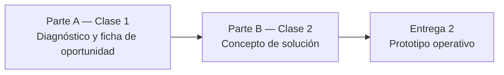

# TP Integrador — Entrega 1: Del Diagnóstico al Concepto de Solución

*Trabajo Práctico entregable — Clases 1 y 2*

**Asignatura:** Microcredencial #2 — Diseño de Aplicaciones Inteligentes

**Objetivo de la entrega:** consolidar lo visto en las Clases 1 y 2 en el primer bloque construible del proyecto integrador — pasar de identificar un problema real a tener un diagnóstico claro de la oportunidad y un concepto de solución concreto, con el user journey, el alcance del MVP y la frontera entre reglas y LLM definida.

---

## Cómo funciona esta entrega

- **Es el punto de partida.** Todo lo que diseñen acá — el caso, el usuario, la frontera regla/LLM — es el material sobre el que construyen las Entregas 2, 3 y 4. La calidad de este diagnóstico inicial determina qué tan sólido va a quedar el resto del proyecto.
- **Ortelana Textil es el ejemplo guía**, no el entregable. Todo lo que resolvemos en clase sobre Ortelana ustedes lo aplican sobre **su propio caso**.
- **Modalidad:** grupal, según los grupos ya conformados.

---

## El hilo conductor



| Parte | Pregunta que responde | Artefacto que produce |
|---|---|---|
| **A** | ¿Existe un problema real donde la IA agregue valor, y qué tan viable es? | Ficha de oportunidad + evidencia de alucinación |
| **B** | ¿Cómo vive el usuario la solución? ¿Qué parte es regla y qué parte es LLM? | User journey + Alcance del MVP + Matriz de Intenciones |

---

## Elección del caso

Elijan **un caso propio**. No pueden usar Ortelana Textil — ese es el caso de la cátedra. Puede ser una idea propia, un negocio que conozcan (el de su familia, donde trabajan, un emprendimiento) o uno ficticio pero concreto. La condición es que tenga **datos desestructurados, procesos manuales, o decisiones que hoy dependen de que una persona lea e interprete algo**.

| Dominio | Caso de uso sugerido |
|---|---|
| Legal | Consulta de jurisprudencia |
| Salud | Asistente de pre-diagnóstico |
| Finanzas | Análisis de documentos o balances |
| Retail | Asistente de stock y pedidos |
| RRHH | Clasificación de CVs |

> [!TIP] **El caso se elige una sola vez**
> Este caso sostendrá las 4 entregas y el Trabajo Final Aplicado de la Clase 8. Elijan algo que les interese y que tenga un problema real detrás.

---

## Parte A — Diagnóstico y Ficha de Oportunidad (Clase 1)

### A.1 — El caso

En 3 o 4 líneas: de qué se trata la empresa o situación, y cuál es el proceso manual o desestructurado que quieren mejorar con IA. Concreto, no abstracto — "una IA que ayuda a la gente" no es suficiente para avanzar.

### A.2 — Evidencia de la necesidad (réplica del taller "El Proveedor Enojado")

Abrir ChatGPT, Claude o Gemini y pedirle que resuelva una consulta real de su dominio **sin darle la fuente de verdad** (sin el reglamento, sin la base de datos, sin el catálogo). Usar este formato de prompt:

```
"Actuá como el sistema de atención de [su empresa].
Un usuario pregunta: '[consulta típica de su dominio que requiere un dato interno]'.
Respondé como lo haría el sistema."
```

**Documentar:**
- La respuesta del modelo, completa (copy-paste real, no parafrasear).
- Qué parte inventó — marcarlo en el texto. ¿Con qué nivel de confianza lo presentó?
- Qué le faltó al modelo para responder bien.

### A.3 — Aplicación de los 4 criterios de viabilidad

| Criterio | Pregunta | Respuesta aplicada a su caso |
|---|---|---|
| **Valor** | ¿El resultado le importa de verdad a alguien? ¿Ahorra tiempo, dinero o reduce error? | |
| **Factibilidad** | ¿Existe un modelo o herramienta capaz de resolverlo hoy, sin inventar tecnología? | |
| **Disponibilidad de datos** | ¿Hay información real (aunque sea desordenada) sobre la que trabajar? | |
| **Riesgo** | ¿Qué pasa si el sistema se equivoca? ¿Es tolerable o crítico? | |

### A.4 — Mapa inicial del sistema (seis piezas)

Completar el mapa de arquitectura conceptual de su caso:

```markdown
## Mapa inicial — [Nombre del caso]

- Usuario: (¿quién interactúa con el sistema?)
- Datos: (¿qué información entra?)
- Modelo: (¿qué LLM usarían: GPT, Claude, Gemini?)
- Herramientas: (¿qué puede ejecutar el sistema: consultar BD, enviar mail, etc.?)
- Reglas: (¿qué límites y validaciones existen?)
- Salida: (¿qué recibe finalmente el usuario?)
```

> [!IMPORTANT] **Lo que tiene que quedar claro al terminar la Parte A**
> El modelo no falló porque sea malo — falló porque no tiene acceso a los datos reales del dominio. Eso es alucinación, y es el problema que resolvemos en las clases siguientes.

---

## Parte B — Concepto de Solución (Clase 2)

### B.1 — Señal de dolor

¿Qué señal dispara la necesidad — **volumen repetitivo**, **carga cognitiva** o **latencia humana**? ¿Quién lo sufre, con qué frecuencia, y qué consecuencia concreta tiene no resolverlo hoy?

### B.2 — User journey

El recorrido del usuario de punta a punta, marcando en cada paso si es una **regla determinista** (código) o una decisión **probabilística** (LLM):

```
Paso 1 → Paso 2 → Paso 3 → ... → Salida

Marcar: [Regla] o [LLM] en cada paso, con una línea de justificación.
```

> [!NOTE] **El dilema técnico**
> No todo necesita un LLM. Un campo numérico se valida con código — es más rápido, más barato y no alucina. El LLM entra donde hay lenguaje natural que interpretar. Justificar cada decisión.

### B.3 — Alcance del MVP

| Sección | Contenido |
|---|---|
| **Capacidades incluidas** | ¿Qué va a poder hacer el sistema en esta primera versión? |
| **Explícitamente fuera de alcance** | ¿Qué NO hace el MVP? |
| **Criterios de éxito** | ¿Cómo saben que el MVP funciona? (una métrica concreta) |

### B.4 — Matriz de Mapeo de Intenciones

Mínimo 3 filas. El riesgo debe estar justificado (no alcanza con escribir "ALTO" — hay que explicar por qué):

| Entrada del usuario (caos) | Intención (LLM) | Acción de backend (determinista) | Riesgo | Justificación del riesgo |
|---|---|---|---|---|
| | | | | |

> [!NOTE] **Regla de oro**
> La IA es el **intérprete**, la base de datos es la **autoridad**. El LLM nunca decide una regla de negocio — la extrae del texto y la comunica; el código la resuelve. El riesgo es ALTO cuando la operación escribe o tiene consecuencia financiera, BAJO cuando solo lee.

### B.5 — Hipótesis más riesgosa

Una sola oración: la suposición que, si resulta falsa, hace colapsar todo el diseño.

---

## Qué se entrega

**Un repositorio Git público por grupo** (GitHub o GitLab). Se entrega solo el link. Como es público, **ninguna clave ni API key entra al repo**. Estructura mínima:

| Archivo | Contenido |
|---|---|
| `README.md` | Caso elegido, integrantes del grupo |
| `entrega_1/informe.md` | Partes A y B completas |
| `.gitignore` | Incluir `.env` desde el primer commit |

> [!NOTE] **Sobre los commits**
> Se espera un historial que muestre trabajo incremental. Un único commit "entrega final" con todo volcado no es evidencia de proceso.

---

## Rúbrica de evaluación

Cada criterio se puntúa en uno de cuatro niveles: **No logrado (0%)**, **En desarrollo (40%)**, **Logrado (75%)**, **Destacado (100%)** del máximo. El total suma 10, igual que la escala del aula virtual.

| # | Criterio | Logrado (75%) significa que... | Máx |
|---|---|---|---|
| 1 | **Caso concreto + evidencia de alucinación** (A.1, A.2) | El caso es específico del dominio; la respuesta real del modelo está pegada con lo inventado marcado | 2 |
| 2 | **Aplicación de los 4 criterios de viabilidad** (A.3) | Los 4 criterios están aplicados al dominio propio con argumentos específicos, no genéricos | 1.5 |
| 3 | **Mapa de seis piezas** (A.4) | Las seis piezas son específicas del caso y coherentes entre sí (no confunden "modelo" con "sistema") | 1.5 |
| 4 | **User journey con frontera regla/LLM** (B.2) | Cada paso está marcado como regla o LLM con al menos una línea de justificación | 2 |
| 5 | **MVP acotado con criterios de éxito** (B.3) | Hay capacidades, límites explícitos y al menos un criterio de éxito concreto y medible | 1.5 |
| 6 | **Matriz de Intenciones** (B.4) | ≥3 intenciones con riesgo justificado por escritura/lectura y consecuencia real; incluye al menos una de riesgo ALTO | 1.5 |
| | **Total** | | **10** |

**Penalizaciones:**

| Situación | Penalización |
|---|---|
| Un único commit con todo volcado (sin historial de proceso) | −0.5 |
| Dominio demasiado vago ("una IA que ayuda con consultas") que impide completar los artefactos correctamente | Criterios 1, 3, 4 y 6 no superan "En desarrollo" |

---

## Conexión con el proyecto

Esta entrega deja el diseño conceptual listo. Lo que sigue:

| Entrega | Capa que se suma |
|---|---|
| Entrega 2 (Clase 3) | El concepto se convierte en código: prompt estructurado + API real + JSON validado |
| Entrega 3 (Clases 4–6) | Workflow encadenado + base de conocimiento vectorial (RAG) + agente con herramientas |
| Entrega 4 (Clase 7) | Integración punta a punta + guardrails + evidencia de calidad |

---

## Bibliografía

- Huyen, C. (2025). *AI Engineering: Building Applications with Foundation Models.* O'Reilly. Capítulo 1.
- Osterwalder, A., & Pigneur, Y. (2014). *Value Proposition Design.* Wiley.
- Mollick, E. (2024). *Co-Intelligence: Living and Working with AI.* Portfolio.
