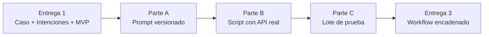

# TP Integrador — Entrega 2: Primer Prototipo Operativo

*Trabajo Práctico entregable — Clase 3*

**Asignatura:** Microcredencial #2 — Diseño de Aplicaciones Inteligentes

**Objetivo de la entrega:** convertir el concepto de solución de la Entrega 1 en código que funciona: un prompt versionado, una llamada real a un modelo de IA, y una salida JSON que el sistema puede procesar. No es un sistema completo — es la primera pieza que demuestra que el diseño es implementable.

---

## Cómo funciona esta entrega

- **Se construye sobre la Entrega 1.** El prompt que diseñen tiene que reflejar las intenciones de la Matriz de la Entrega 1. Si hay inconsistencias entre ambas, el diseño inicial tiene un problema.
- **Ortelana Textil es el ejemplo guía** — el laboratorio de la Clase 3 trabajó sobre ese caso. Lo que entregan es exactamente lo mismo pero sobre **su propio caso**.
- **Modalidad:** grupal, en el mismo repositorio de la Entrega 1.

---

## El hilo conductor



---

## Parte A — Prompt versionado

### A.1 — Técnica de prompting

Elegir entre **zero-shot** o **few-shot** para el prompt principal de extracción de intenciones. Justificar la elección con al menos 2 oraciones: ¿por qué esa técnica funciona para su caso?

| Técnica | Cuándo usarla |
|---|---|
| **Zero-shot** | El input es simple y bien definido. El modelo puede entender el formato solo con la instrucción. |
| **Few-shot** | El input puede ser ambiguo o el formato es complejo. Los ejemplos guían al modelo sobre casos límite. |

> [!NOTE] **Si el zero-shot falla en algún input de su lote de prueba...**
> Eso es evidencia perfecta de que necesitaban few-shot. Documentarlo: "el caso X fallaba con zero-shot, con few-shot pasó". Eso vale más que un prompt perfecto que nunca se probó.

### A.2 — System prompt de extracción

Diseñar el System Prompt que convierte el input de texto libre del usuario en JSON estructurado. Debe cumplir las 4 reglas para un JSON confiable:

1. **Schema exacto**: nombrar cada clave y su tipo (`string`, `number`, `null`).
2. **Prohibir texto extra**: la respuesta debe empezar con `{` y terminar con `}`, sin explicaciones.
3. **Definir el fallback**: qué valor debe tener un campo cuando el modelo no puede extraerlo con certeza (`null` es la convención).
4. **Incluir los valores válidos de intención**: los mismos que en la Matriz de la Entrega 1, sin excepciones.

**Ejemplo de estructura (adaptar al dominio):**

```
[System]
Sos un extractor de datos para [nombre del sistema].
Respondé siempre en JSON con esta estructura exacta:
{"intencion": "VALOR_EXACTO", "campo_1": "...", "campo_2": null}

Los únicos valores válidos para "intencion" son: INTENCION_1, INTENCION_2, INTENCION_3.
Si no podés extraer un campo con certeza, usá null.
No incluyas texto explicativo — la respuesta debe empezar con { y terminar con }.
```

---

## Parte B — Script con API real

### B.1 — Script funcional

Un script (`app.py`) o notebook que:

1. Lea la API key desde `.env` — **nunca hardcodeada**. Entregar un `.env.example` sin claves.
2. Envíe un input del dominio propio a una API real (OpenAI, Anthropic o Gemini).
3. Obtenga la respuesta y la parsee como JSON con `json.loads()`.
4. Maneje los dos tipos de error por separado: JSON inválido (el modelo no cumplió el formato) y falla de red/autenticación (no llegó a responder).
5. Imprima los campos extraídos y validados.

```python
import json, os
from dotenv import load_dotenv

load_dotenv()
api_key = os.getenv("API_KEY_DEL_PROVEEDOR")

# ... llamada al modelo ...

try:
    datos = json.loads(respuesta_texto)
    print("Extracción exitosa:", datos)
except json.JSONDecodeError:
    print("El modelo no devolvió JSON válido. Respuesta cruda:", respuesta_texto)
except Exception as e:
    print("Falla de comunicación con el proveedor:", e)
```

> [!WARNING] **La API Key nunca se sube al repositorio — y en Git, borrarla después no salva.**
> La key queda en el **historial de commits** aunque la borren en un commit posterior. Los bots escanean GitHub en tiempo real y una key expuesta se compromete en minutos.
> Reglas: `.env` en `.gitignore` **desde el primer commit**; subir solo `.env.example` sin valores; si una key se filtró, hay que **rotarla** (darla de baja y generar una nueva).

### B.2 — Documentación del contrato

Una sección en el `README.md` (o en `entrega_2/informe.md`) que documente el contrato de entrada y salida del componente:

```markdown
## Contrato del prototipo

**Entrada (input del usuario):**
Texto libre en español con una consulta de [dominio].

**Salida (JSON):**
{
  "intencion": "INTENCION_1 | INTENCION_2 | INTENCION_3",
  "campo_1": "string | null",
  "campo_2": "número | null"
}

**API usada:** [nombre del proveedor y modelo]
**Técnica de prompting:** zero-shot / few-shot
```

---

## Parte C — Lote de prueba y tabla de resultados

### C.1 — Lote de 4 inputs

Armar **4 inputs de su dominio**, incluyendo obligatoriamente:
- 1 input típico y bien formado.
- 1 input ambiguo o incompleto.
- 1 intento de manipulación o lenguaje hostil (similar al laboratorio de la Clase 2: un usuario que intenta que el sistema haga algo que no debe).
- 1 input de su elección (un caso límite propio del dominio).

Correr el script sobre los 4 y completar:

| # | Input (resumido) | Salida del modelo | ¿JSON válido? | Tipo de error si falló |
|---|---|---|---|---|
| 1 | | | | |
| 2 | | | | |
| 3 | | | | |
| 4 | | | | |

### C.2 — Reflexión del lote (en `entrega_2/informe.md`)

3 o 4 líneas: ¿hubo algún input que sorprendiera? ¿El intento de manipulación fue resistido o el modelo cedió? ¿Qué mejorarían del prompt para la Entrega 3?

---

## Qué se entrega

En el mismo repositorio Git de la Entrega 1. Agregar los nuevos archivos con commits separados:

| Archivo | Contenido |
|---|---|
| `entrega_2/app.py` o `entrega_2/prototipo.ipynb` | El script funcional de la Parte B |
| `entrega_2/informe.md` | Parte A (técnica elegida + prompt versionado), contrato documentado y reflexión de C.2 |
| `entrega_2/resultados_lote.md` | La tabla de la Parte C |
| `.env.example` | Variables de entorno sin valores reales |
| `.gitignore` | Debe incluir `.env` (si no estaba ya desde la Entrega 1) |

> [!NOTE] **El prompt es la versión 1**
> Al versionarlo (aunque sea como `v1` en un comentario o en el nombre del archivo), ya tienen trazabilidad. En la Entrega 3 el prompt puede evolucionar — poder comparar `v1` vs. `v2` es parte del aprendizaje.

---

## Rúbrica de evaluación

Cada criterio se puntúa en uno de cuatro niveles: **No logrado (0%)**, **En desarrollo (40%)**, **Logrado (75%)**, **Destacado (100%)** del máximo. El total suma 10, igual que la escala del aula virtual.

| # | Criterio | Logrado (75%) significa que... | Máx |
|---|---|---|---|
| 1 | **Prompt estructurado con técnica justificada** (A.1, A.2) | El prompt tiene schema exacto, prohíbe texto extra, define fallback y los valores del `intencion` coinciden exactamente con los de la Matriz de la Entrega 1. La técnica está justificada. | 2.5 |
| 2 | **Script funcional con credenciales en `.env`** (B.1) | Corre de punta a punta, la key se lee desde `.env`, `.env.example` está subido y `.env` está ignorado. | 3 |
| 3 | **Manejo de errores diferenciado** (B.1) | JSON inválido y falla de red se capturan por separado, con mensajes distintos. El script no rompe ante un input basura. | 2 |
| 4 | **Lote de prueba con tabla completa** (C.1, C.2) | 4 inputs incluyendo el ambiguo y el de manipulación; tabla completa; reflexión con al menos una conclusión concreta sobre el prompt. | 2.5 |
| | **Total** | | **10** |

**Penalizaciones:**

| Situación | Penalización |
|---|---|
| API key real en algún commit (aunque esté borrada después) | −1.5 y aviso para rotar la key |
| `.env` no está en `.gitignore` | −0.5 |
| El script no corre en la máquina del docente por algo evitable (path hardcodeado, dependencia sin declarar en el README) | Criterio 2 baja un nivel |
| Los valores de `intencion` en el prompt no coinciden con la Matriz de la Entrega 1 | Criterio 1 no supera "En desarrollo" |

---

## Preguntas frecuentes

**¿Podemos usar Colab en vez de un script local?**
Sí. Un notebook `.ipynb` es válido. La key debe leerse igualmente desde una variable de entorno o, si usan Colab, desde `google.colab.userdata` — nunca hardcodeada en una celda.

**¿Y si no tenemos créditos en ninguna API?**
Los modelos económicos (`gpt-4o-mini`, `claude-haiku`, `gemini-1.5-flash`) procesan este lote por centavos. Coordinar con la cátedra si hay un bloqueo real.

**¿Tenemos que usar Pydantic?**
No es obligatorio para esta entrega. El objetivo es que el JSON sea válido y el código lo procese correctamente — `json.loads()` con manejo de excepciones cumple el requisito. Pydantic es la profundización natural si quieren más robustez.

---

## Conexión con el proyecto

| Entrega | Capa que se suma |
|---|---|
| Entrega 3 (Clases 4–6) | Esta llamada suelta se convierte en un workflow encadenado de 3-4 pasos, se agrega una base de conocimiento vectorial (RAG) y se implementa un agente |
| Entrega 4 (Clase 7) | Todo se integra de punta a punta con guardrails, matriz de pruebas y ficha de riesgos |

---

## Bibliografía

- Documentación oficial del proveedor elegido (OpenAI / Anthropic / Google).
- Huyen, C. (2025). *AI Engineering: Building Applications with Foundation Models.* O'Reilly. Capítulo 3.
- White, J., et al. (2023). *A Prompt Pattern Catalog to Enhance Prompt Engineering with ChatGPT.*
