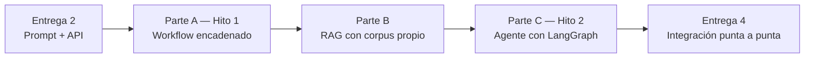

# TP Integrador — Entrega 3: Workflow + RAG + Agente

*Trabajo Práctico entregable — Clases 4, 5 y 6 · Hitos 1 y 2*

**Asignatura:** Microcredencial #2 — Diseño de Aplicaciones Inteligentes

**Objetivo de la entrega:** convertir la llamada suelta de la Entrega 2 en un sistema con tres capas: un **workflow encadenado** con pasos y validaciones (Clase 4), una **base de conocimiento vectorial con RAG** que ancla las respuestas en datos reales (Clase 5), y un **agente** que elige dinámicamente qué herramientas usar (Clase 6).

---

## Cómo funciona esta entrega

- **Es la entrega más extensa.** Cubre tres clases y tiene dos hitos intermedios (Hito 1 en Clase 4, Hito 2 en Clase 6). Se puede ir entregando en partes — el repositorio muestra el progreso.
- **Se construye sobre las Entregas 1 y 2.** El workflow usa el prompt de la E2. El RAG agrega la base de conocimiento que faltaba. El agente reemplaza el workflow fijo con decisión dinámica.
- **Modalidad:** grupal, en el mismo repositorio.

---

## El hilo conductor



---

## Parte A — Workflow encadenado (Clase 4 — Hito 1)

### A.1 — Workflow de 3 o 4 pasos

Construir un workflow sobre el caso propio con estos cuatro pasos como referencia (adaptar al dominio):

```
Mensaje del usuario
    → [Paso 1] LLM extrae intención y datos (reusar/mejorar el prompt de la E2)
    → [Paso 2] Código valida los datos extraídos (un campo clave del dominio)
    → [Paso 3] Si la validación falla → detener y marcar para revisión humana
    → [Paso 4] LLM redacta la respuesta final usando los datos validados
```

El mínimo requerido:
- Al menos **3 pasos** en secuencia.
- Al menos **una validación en código** (no en el LLM) con lógica real del dominio.
- Al menos **un punto de control** donde el flujo puede detenerse antes de seguir.

```python
def workflow_caso_propio(mensaje: str) -> dict:
    datos = extraer_datos_llm(mensaje)          # Paso 1 — LLM
    es_valido = validar_campo_clave(datos)      # Paso 2 — Regla/código

    if not es_valido:
        return {"estado": "REVISION_HUMANA", "motivo": "Campo inválido"}

    respuesta = redactar_respuesta_llm(datos)   # Paso 4 — LLM
    return {"estado": "COMPLETADO", "respuesta": respuesta}
```

### A.2 — Diagrama del workflow

Actualizar el diagrama de la solución (puede ser Mermaid, Miro, Excalidraw o texto ASCII). Debe mostrar los pasos, los puntos de decisión y qué parte es LLM vs. regla.

### A.3 — Prueba de falla controlada

Ejecutar el workflow con al menos:
- 1 caso que debería completarse correctamente.
- 1 caso que debería detenerse en el punto de control (validación que falla).

Documentar qué pasó en cada uno y en qué paso se detuvo el flujo.

> [!IMPORTANT] **Hito 1 — Concepto validado**
> El workflow tiene que ser ejecutable, no un diagrama. Que corra de punta a punta con esos dos casos es el criterio de aprobación del Hito 1.

---

## Parte B — RAG: Base de Conocimiento Vectorial (Clase 5)

### B.1 — Corpus propio

Preparar un corpus de **mínimo 10-15 documentos** vinculados al caso propio. Cada documento debe tener:
- Un campo `descripcion_semantica`: texto rico en significado (descripción detallada, sinónimos, contexto de uso). Cuanto más específico, mejor calidad tendrá el embedding.
- Al menos **dos metadatos** que sirvan para filtrar (ej: categoría, disponibilidad, fecha, región).

```json
{
  "id": "DOC-001",
  "descripcion_semantica": "Descripción detallada del elemento, sus características, sinónimos y contexto de uso. Cuanto más específica, mejor.",
  "metadatos": {
    "categoria": "...",
    "disponible": true,
    "tag_extra": "..."
  }
}
```

> [!NOTE] **Qué va como metadato y qué va en el texto**
> Todo lo que alguien necesite filtrar de forma exacta (categoría, disponibilidad, fecha) va como metadato. Lo puramente descriptivo (características, sinónimos, contexto) va en el texto para que lo procese la búsqueda semántica.

### B.2 — RAG operativo

Construir la recuperación semántica con **FAISS** o **ChromaDB**:

1. Generar embeddings del corpus y construir el índice.
2. Implementar la recuperación: la consulta del usuario se convierte en embedding y se recuperan los k documentos más similares.
3. Si el corpus tiene metadatos útiles, implementar **filtrado híbrido**: combinación de búsqueda semántica + filtro por metadato (ej: `where={"disponible": True}`).
4. Conectar la recuperación con el LLM: la pregunta + los documentos recuperados se envían al modelo con la instrucción de usar **únicamente el contexto provisto**.

```
System prompt base con RAG:
"Sos el asistente de [nombre del sistema].
Usá ÚNICAMENTE los fragmentos del corpus provistos para responder.
Si la respuesta no puede deducirse del contexto, respondé:
'No tengo información oficial sobre esa consulta.'

Contexto recuperado:
{contexto}

Consulta:
{pregunta}"
```

### B.3 — Comparación antes/después

Con al menos **2 preguntas del dominio**, comparar:

| Pregunta | Respuesta sin grounding (E2 — solo el modelo) | Respuesta con RAG (hoy) | ¿Mejoró fidelidad? |
|---|---|---|---|
| | | | |

> [!NOTE] **El caso "no tengo información"**
> Una pregunta fuera del corpus (que el modelo no puede responder con los datos provistos) debería generar la respuesta de fallback, no una invención. Incluir este caso en la comparación es "Destacado".

---

## Parte C — Agente con LangGraph (Clase 6 — Hito 2)

### C.1 — Herramientas del agente

Definir **2 o 3 herramientas acotadas** para el caso propio. El docstring de cada herramienta es lo que el LLM lee para decidir cuándo usarla — tiene que ser preciso:

```python
from langchain_core.tools import tool

@tool
def herramienta_1(parametro: str) -> str:
    """
    Descripción precisa de qué hace esta herramienta y cuándo usarla.
    Ejemplo: "Busca [X] en la base de datos de [sistema] por [parámetro].
    Usar cuando el usuario pregunta por [caso de uso específico]."
    """
    ...
```

Clasificar cada herramienta como **sensor** (solo lee, bajo riesgo) o **actuador** (escribe o tiene efecto real, alto riesgo).

### C.2 — Agente con LangGraph

Implementar el agente usando el patrón ReAct:

```python
from langgraph.graph import StateGraph, END
from langgraph.prebuilt import ToolNode

# Estado mínimo requerido
class EstadoAgente(TypedDict):
    messages: Annotated[Sequence[BaseMessage], operator.add]
    iteraciones: int

# Nodos, aristas y condición de finalización
grafo = StateGraph(EstadoAgente)
# ... (ver código de la Clase 6)
```

Requisitos mínimos:
- Estado con al menos `messages` y un campo de control (iteraciones o similar).
- Condición de finalización explícita (no loop infinito).
- Al menos un **punto de control de riesgo**: si el agente detecta una acción de alto riesgo (un actuador), debe detenerse y marcar el caso para revisión humana en lugar de ejecutarlo solo.

### C.3 — Diagrama del agente (Hito 2)

Actualizar el diagrama del sistema para reflejar el agente:
- Qué herramientas tiene disponibles.
- Qué parte del estado gestiona.
- Cuál es la condición de control de riesgo.

### C.4 — Test de validación

Ejecutar el agente con una consulta que necesite **dos herramientas distintas** y verificar:
- El agente usó ambas herramientas en un orden razonable.
- No entró en un loop.
- Si había una acción de alto riesgo en el path, se detuvo correctamente.

Documentar la traza de mensajes (qué herramientas eligió el agente y en qué orden).

> [!IMPORTANT] **Hito 2 — Esquema técnico**
> El diagrama de componentes del agente (herramientas, estados, flujo de control) es el artefacto del Hito 2. Tiene que estar en el repositorio al cierre de la Clase 6.

---

## Qué se entrega

En el mismo repositorio. Estructura nueva que se agrega:

| Archivo | Contenido |
|---|---|
| `entrega_3/workflow.py` | Workflow de la Parte A |
| `entrega_3/corpus/` | Los documentos del corpus en JSON o similar |
| `entrega_3/rag.py` o `entrega_3/rag.ipynb` | Pipeline RAG de la Parte B |
| `entrega_3/agente.py` o `entrega_3/agente.ipynb` | Agente de la Parte C |
| `entrega_3/informe.md` | Diagrama del workflow (A.2), comparación antes/después (B.3), diagrama del agente (C.3) y resultado del test de validación (C.4) |

> [!NOTE] **El historial de commits importa más acá**
> Esta entrega cubre 3 clases. Se espera ver commits que reflejen el trabajo incremental: primero el workflow, después el RAG, después el agente. Un único commit con todo junto es señal de que se hizo todo en un día.

---

## Rúbrica de evaluación

Cada criterio se puntúa en uno de cuatro niveles: **No logrado (0%)**, **En desarrollo (40%)**, **Logrado (75%)**, **Destacado (100%)** del máximo. El total suma 10, igual que la escala del aula virtual.

| # | Criterio | Logrado (75%) significa que... | Máx |
|---|---|---|---|
| 1 | **Workflow ejecutable con pasos claros** (A.1, A.3) | Corre de punta a punta; los 3+ pasos son distinguibles; el caso de falla controlada se detiene en el punto correcto | 1.5 |
| 2 | **Punto de control y validación real** (A.1) | La validación es en código con lógica del dominio (no solo `if True`); el punto de control es explícito | 1 |
| 3 | **Corpus bien estructurado** (B.1) | ≥10-15 documentos; `descripcion_semantica` específica del dominio (no genérica); al menos 2 metadatos útiles para filtrar | 1.5 |
| 4 | **RAG operativo con comparación** (B.2, B.3) | Recuperación semántica funciona; el LLM usa únicamente el contexto provisto; comparación antes/después con al menos 2 preguntas | 2 |
| 5 | **Agente con herramientas y estado** (C.1, C.2) | 2-3 herramientas con docstrings precisos; estado mínimo implementado; condición de finalización explícita | 2 |
| 6 | **Control de riesgo documentado** (C.2, C.3, C.4) | Al menos un punto de control de riesgo implementado; traza del test de validación documentada; diagrama del agente incluido | 2 |
| | **Total** | | **10** |

**Penalizaciones:**

| Situación | Penalización |
|---|---|
| API key real en algún commit | −1.5 y aviso para rotar |
| El workflow no corre o el agente no corre por algo evitable | El criterio correspondiente baja un nivel |
| Un único commit para toda la entrega (3 clases en un commit) | −0.5 |
| Los docstrings de las herramientas son vagos o genéricos | Criterio 5 no supera "En desarrollo" (el agente no puede elegir bien sin descripciones precisas) |

---

## Preguntas frecuentes

**¿Tenemos que usar LangChain para el workflow?**
No es obligatorio. Código Python directo es válido. LangChain simplifica el armado de cadenas, pero no es un requisito — lo que se evalúa es que el workflow tenga pasos claros, dependencias y puntos de control.

**¿Qué pasa si el corpus propio es pequeño?**
El mínimo son 10-15 documentos. Si el dominio tiene pocos items reales, pueden inventar datos ficticios pero consistentes con el dominio (como hicimos con el catálogo de Ortelana). Lo que no vale es un corpus genérico ("documento 1", "documento 2") sin relación con el caso.

**¿El agente tiene que reemplazar el workflow?**
No necesariamente. En una arquitectura real coexisten: el workflow para flujos predecibles y el agente para consultas abiertas. Para la entrega pueden tenerlos como componentes separados.

---

## Conexión con el proyecto

| Entrega | Capa que se suma |
|---|---|
| Entrega 4 (Clase 7) | Todo lo construido se integra en un recorrido de punta a punta, se le agregan guardrails, una matriz de pruebas y una ficha de riesgos |
| Clase 8 — TFA | Defensa del sistema completo |

---

## Bibliografía

- Documentación oficial de LangGraph — langchain-ai.github.io/langgraph
- Documentación oficial de ChromaDB — docs.trychroma.com
- Lewis, M., et al. (2020). *Retrieval-Augmented Generation for Knowledge-Intensive NLP Tasks.*
- Yao, S., et al. (2022). *ReAct: Synergizing Reasoning and Acting in Language Models.*
