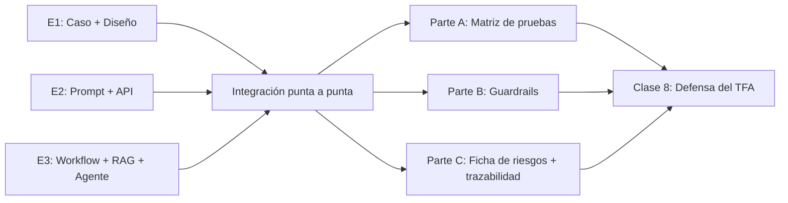

# TP Integrador — Entrega 4: Versión Candidata (Integración Punta a Punta)

*Trabajo Práctico entregable — Clase 7*

**Asignatura:** Microcredencial #2 — Diseño de Aplicaciones Inteligentes

**Objetivo de la entrega:** integrar todo lo construido en las Entregas 1, 2 y 3 en un único recorrido ejecutable de punta a punta, someterlo a pruebas de calidad, implementar al menos un guardrail de diseño responsable, y documentar los riesgos del sistema con sus controles. Esta es la versión candidata que se defiende en la Clase 8.

---

## Cómo funciona esta entrega

- **Es la entrega de cierre.** No se agrega funcionalidad nueva — se integra lo que ya existe y se verifica que funcione como un sistema, no como piezas sueltas.
- **La Clase 8 usa esta entrega.** Lo que el grupo defiende es exactamente lo que entregan acá, más la presentación oral.
- **Modalidad:** grupal, mismo repositorio.

---

## El hilo conductor



---

## Parte A — Integración y Matriz de Pruebas

### A.1 — Recorrido integrado

Armar un único punto de entrada (puede ser un notebook, una interfaz simple con Streamlit/Gradio, o un script) que ejecute el recorrido completo del caso propio:

```
Input del usuario
    → Concepto de solución (Entrega 1)
    → Extracción con LLM + JSON validado (Entrega 2)
    → Workflow con validación (Entrega 3-A)
    → Recuperación semántica con RAG (Entrega 3-B)
    → Agente con herramientas (Entrega 3-C, si el caso lo requiere)
    → Respuesta fundamentada en datos reales
```

El recorrido no tiene que ser lineal — puede usar el agente o el workflow según el tipo de consulta. Lo importante es que **las piezas se hablen entre sí**, no que estén en carpetas separadas sin conexión.

**Opciones de empaquetado (cualquiera es válida):**

| Nivel | Formato | Cuándo alcanza |
|---|---|---|
| **Notebook** | Un Colab o Jupyter que corre de punta a punta | Suficiente para la mayoría de los proyectos |
| **Interfaz simple** | Un front mínimo con Streamlit o Gradio | Si el grupo quiere una demo más visual para la Clase 8 |
| **Endpoint local** | Una API con FastAPI corriendo localmente | Opcional, para grupos con más dominio técnico |

> [!TIP] **Consejo para la demo de la Clase 8**
> Demostrar algo simple que funciona bien vale más que demostrar algo ambicioso que falla a mitad. Si hay dudas sobre si algo va a funcionar en vivo, tener un plan B (una captura de pantalla del resultado esperado).

### A.2 — Matriz de pruebas

Diseñar y ejecutar **mínimo 5 casos**, cubriendo obligatoriamente:

| # | Consulta | Tipo | Resultado esperado | Resultado obtenido | ¿Correcto? |
|---|---|---|---|---|---|
| 1 | | Consulta típica | | | |
| 2 | | Consulta con sinónimos/jerga | | | |
| 3 | | Consulta fuera de dominio | "No tengo información" | | |
| 4 | | Intento de manipulación | Rechaza / no confirma | | |
| 5 | | Caso límite del dominio propio | | | |

> [!NOTE] **Los casos 3 y 4 son obligatorios**
> Un sistema que solo maneja los casos felices no está listo. La Clase 8 va a incluir preguntas sobre qué pasa cuando el sistema recibe algo que no debería.

---

## Parte B — Guardrails de Diseño Responsable

Implementar y documentar **al menos 1** de los 4 guardrails. El guardrail tiene que ser **demostrable en vivo** (o con evidencia en el informe):

### Guardrail 1 — Anclaje al contexto (ya construido en la E3)

Reforzar la instrucción "responder únicamente con el contexto provisto" y el fallback "no tengo información sobre eso". Demostrar con el Caso 3 de la matriz (consulta fuera de dominio): el sistema dice "no tengo información" en vez de inventar.

**Evidencia mínima:** captura o output del Caso 3 donde el sistema no inventa.

### Guardrail 2 — Privacidad (PII)

Si el sistema maneja datos sensibles (nombres, documentos, datos de salud, datos financieros): verificar que la respuesta no expone esos datos cuando no corresponde.

**Evidencia mínima:** mostrar un input con un dato sensible y verificar que la respuesta no lo repite innecesariamente.

### Guardrail 3 — Revisión de sesgo (básica)

Probar la misma consulta con 2 o 3 variaciones superficiales (distinto registro de lenguaje, distinto nombre, distinto origen geográfico simulado) y documentar que la calidad de la respuesta no cambia de forma injusta.

**Evidencia mínima:** tabla con las 2-3 variaciones y si la calidad fue similar o cambió.

### Guardrail 4 — Resistencia a manipulación (prompt injection)

Usar el Caso 4 de la matriz para demostrar que el sistema rechaza un intento de que confirme algo que no debe (un dato falso, una aprobación no autorizada, una instrucción que contradice las reglas de negocio).

**Evidencia mínima:** output del Caso 4 donde el sistema rechaza o ignora la manipulación.

> [!NOTE] **¿Cuál guardrail elegir?**
> El Guardrail 1 (anclaje) ya está construido desde la E3 — si el RAG funciona correctamente, es el más fácil de demostrar. El Guardrail 4 (manipulación) es el más visible en la demo. Cualquiera cuenta.

---

## Parte C — Trazabilidad Mínima y Ficha de Riesgos

### C.1 — Trazabilidad mínima

Agregar al sistema un registro simple de cada interacción:

```python
# Ejemplo mínimo — no requiere infraestructura
registro = {
    "consulta": pregunta,
    "respuesta": respuesta,
    "duracion_seg": duracion,
    "version_prompt": "v2",       # qué versión del prompt se usó
    "resultado": "correcto"        # correcto | parcial | incorrecto
}
```

No hace falta un sistema de logging de producción — una lista en memoria, un archivo de texto o un log en el notebook es suficiente. Lo que se evalúa es que **exista algún registro** y que incluya la versión del prompt.

### C.2 — Ficha de riesgos y controles

Documentar al menos 3 riesgos del sistema con su impacto y el control que los mitiga:

```markdown
## Ficha de riesgos — [Nombre del sistema]

| # | Riesgo | Probabilidad | Impacto | Control implementado |
|---|---|---|---|---|
| 1 | El modelo inventa un dato que no está en el corpus | Media | Alto | Guardrail de anclaje al contexto + fallback "no tengo información" |
| 2 | Un usuario manipula el system prompt | Baja | Alto | Resistencia a prompt injection (Caso 4 de la matriz) |
| 3 | [riesgo específico del dominio] | | | |
```

> [!NOTE] **Por qué importa la ficha de riesgos**
> En la Clase 8 el docente puede preguntar: "¿cuál es el riesgo más importante de su sistema?" o "¿qué pasa si el sistema se equivoca?". La ficha de riesgos es la evidencia de que pensaron esto de antemano — no en el momento en que lo preguntan.

---

## Qué se entrega

En el mismo repositorio. Estructura nueva:

| Archivo | Contenido |
|---|---|
| `entrega_4/main.py` o `entrega_4/prototipo_integrado.ipynb` | El recorrido integrado de la Parte A |
| `entrega_4/informe.md` | Descripción del empaquetado elegido + documentación del guardrail (B) + trazabilidad mínima (C.1) |
| `entrega_4/matriz_pruebas.md` | La tabla completa de la Parte A.2 |
| `entrega_4/ficha_riesgos.md` | La ficha de la Parte C.2 |

---

## Rúbrica de evaluación

Cada criterio se puntúa en uno de cuatro niveles: **No logrado (0%)**, **En desarrollo (40%)**, **Logrado (75%)**, **Destacado (100%)** del máximo. El total suma 10, igual que la escala del aula virtual.

| # | Criterio | Logrado (75%) significa que... | Máx |
|---|---|---|---|
| 1 | **Integración punta a punta ejecutable** (A.1) | El recorrido corre de punta a punta con al menos una consulta real; las piezas de E2 y E3 están conectadas (no son scripts sueltos) | 2.5 |
| 2 | **Matriz de pruebas completa** (A.2) | 5 casos incluyendo el de fuera-de-dominio y el de manipulación; tabla completa con resultado esperado vs. obtenido | 2 |
| 3 | **Guardrail implementado y demostrable** (B) | Al menos 1 guardrail activo con evidencia documentada que demuestra que funciona (output real, no solo que "se implementó") | 2 |
| 4 | **Trazabilidad mínima + ficha de riesgos** (C) | Hay al menos un registro de interacción con versión de prompt; ficha con ≥3 riesgos del dominio, probabilidad, impacto y control | 2 |
| 5 | **Coherencia transversal** | El sistema integrado usa las mismas intenciones de E1, el mismo prompt de E2 y los componentes de E3 — todo es coherente sin contradicciones | 1.5 |
| | **Total** | | **10** |

**Penalizaciones:**

| Situación | Penalización |
|---|---|
| API key real en algún commit | −1.5 y aviso para rotar |
| El recorrido integrado no corre por algo evitable | Criterio 1 baja un nivel |
| La matriz solo tiene casos exitosos (sin los obligatorios 3 y 4) | Criterio 2 no supera "En desarrollo" |
| El guardrail está documentado pero no es demostrable | Criterio 3 no supera "En desarrollo" |

---

## Preguntas frecuentes

**¿Tenemos que conectar el agente Y el workflow en la integración?**
Depende del diseño. Si en la E3 definieron que el agente reemplaza al workflow para consultas abiertas, la integración lo puede reflejar así. Si los tienen para casos distintos (workflow para flujos predecibles, agente para preguntas abiertas), la integración puede enrutar según el tipo de consulta. Lo que no vale es tener los dos en carpetas separadas sin conexión.

**¿El guardrail tiene que ser código nuevo o puede ser algo que ya construimos?**
Puede ser algo que ya construyeron (el RAG con "únicamente el contexto provisto" ya es el Guardrail 1). Lo que se requiere es que esté **documentado y demostrable** — que aparezca en la evidencia de la matriz y en el informe.

**¿Streamlit o Gradio son obligatorios?**
No. Un notebook es suficiente. La interfaz es una opción para quienes quieran una demo más visual en la Clase 8 — no afecta la nota.

---

## Conexión con la Clase 8

La Clase 8 es la **defensa del Trabajo Final Aplicado**. La estructura de la defensa es:

```
[0:00–3:00]  Presentación del problema y la arquitectura
[3:00–9:00]  Demostración del recorrido integrado con 2-3 consultas reales
[9:00–12:00] Evidencia de robustez: matriz de pruebas, guardrail en vivo, ficha de riesgos
[12:00–15:00] Límites conocidos, próximos pasos y preguntas
```

Esta Entrega 4 provee exactamente el material de los bloques 2, 3 y 4 de esa estructura.

---

## Bibliografía

- Huyen, C. (2025). *AI Engineering: Building Applications with Foundation Models.* O'Reilly. Capítulos 9-11.
- OWASP LLM Top 10 (2023). *Top 10 risks for LLM applications.*
- Mollick, E. (2024). *Co-Intelligence: Living and Working with AI.* Portfolio.
